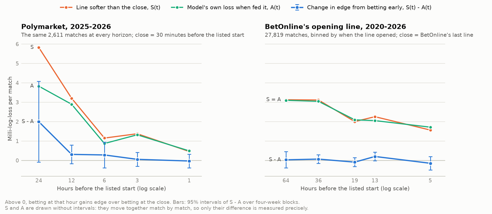

# Betting before the close: what feeding the model the price of the moment costs, and what the softer line gives

8 October 2026 · Written for the owner · Research evidence, not a decision.

**The owner's question.** "Right now our best performing model tabpfn3.5 nonthinking with the speed adjust uses the closing line as input in its model. The crux of this problem is betting earlier than close is more profitable, but it makes the best feature in our model less accurate. We dont have data to train our program on the time out from a match we want to bet I believe? Is there a way to quantify how big of a deal it is to bet earlier than the close, while using the current line as input for the 'Closing line' feature in our model? It will be less accurate, but the line will also be softer. If so explore it and find that process. How should we deal with this problem?"

**How to read the numbers.** Log loss: lower is better. Edges and differences are in milli-log-loss (mLL, thousandths of a nat per match), and each is labelled with what positive means. Brackets are 95% intervals: paired cluster-t intervals over four-week blocks of tournament dates for means, a bootstrap of the same blocks for ratios. **A range that spans 0 is a tie**, whatever the sign. Money is profit per unit staked (ROI) or per 100 matches.

## The answer in short

* **Yes, it can be measured exactly, without early prices for training.** For a bet time t, the model's edge over the price it bets into is the edge at the close, plus how much softer the early line is (S), minus how much accuracy the model loses by being fed it (A). **So the whole question is S − A** ([method](#the-method-one-identity-measured-where-early-prices-exist)). It needs early prices only to score, on matches where every input existed at t, and those now exist.
* **The data.** You were right for the training seasons as they stood this morning: no early price before 2024. Two sources are now held:
  * BetOnline's opening line, with its time. 2024–2026 was already held; **2018–2023 was pulled today** (643 requests, no block). That gives about 34,000 main-tour matches, the opening a median 24–38 hours before the start depending on the season.
  * Polymarket's price at any minute, from September 2025.
* **BetOnline: betting at the opening line changes nothing** (2020–2026, 27,819 matches; mLL, + = betting early gains edge).
  * The opening line's log loss is 2.67 [+1.77, +3.58] mLL worse than BetOnline's last line: softer, as you expected. But the model fed it is 2.64 worse too: it inherits 99% of that softness.
  * S − A = **+0.04 [−0.12, +0.19], a tie**, at every opening time from 5 to 64 hours out. 2020–2024 alone: +0.10 [−0.08, +0.28], a tie.
  * The line moves 2.5 points of probability on average between open and close, but not toward the model (slope +0.01 [−0.02, +0.04]).
  * The model beats both lines by the same amount (+ = model better): +1.39 [+0.64, +2.14] at the opening and +1.35 [+0.63, +2.07] at the last line.
  * Money, your staking rule: +1.30% ROI at the opening and +1.51% at the last line. Opening minus last line: −0.27 units per 100 matches [−1.20, +0.66], a tie.
  * The one systematic difference is small: opening bets lose 3.2% to the closing line instead of the 3.5% margin (closing-line value +0.47 units per 100 matches [+0.22, +0.71]).
  * Men gain a little: +0.22 [+0.06, +0.38]. Women: −0.17, a tie.
* **Polymarket: betting 24–48 hours out is where the model's edge is** (2025–2026; mLL, + = model better).
  * At the 30-minute close the model has no edge: +0.10 [−3.89, +4.08], a tie.
  * Fed the price 24 hours out, it beats that price by +2.11 [−0.93, +5.14] (a tie on its own). Fed the price 48 hours out, it beats it by +5.03 [+0.49, +9.56].
  * The early line gives away more than the model inherits. At 24 hours S − A is **+2.01 [−0.08, +4.10]**, borderline (65% inherited). At 48 hours it is **+2.32 [+0.03, +4.62]**, a gain (78% inherited).
  * From 12 hours on, every horizon is a tie (+0.36 at 12 h, +0.19 at 6 h).
  * Between 24–48 hours and the close, the price moves 29–45% of the way toward the model.
  * Money, fees and the half-cent spread included: early bets have clearly better closing-line value, +1.34 units per 100 matches at 24 h [+0.41, +2.26] and +2.47 at 48 h [+0.53, +4.40]. The realized difference is a tie (+0.50 and +1.76 per 100). This is one season.
* **The plug-in does not need fixing.**
  * It is not mis-sized early: the realisation of its disagreement is 1.15 at BetOnline's opening and 1.11 at its last line.
  * A walk-forward re-sizing gains the same at both (+0.12 and +0.13, ties).
  * **A model trained on the opening line itself does not beat it.** On the same rows and matches, fed the opening line: +0.22 [−0.09, +0.54], a tie (+ = the opening-trained model better). The current best model, trained on more seasons of closes, ties it too (−0.15 [−0.91, +0.61]).
  * So the missing early-price training data costs nothing detectable.
* **A sharp consensus as the input (your follow-up; [section 6](#6-a-consensus-of-the-sharp-lines-as-the-input-the-owners-follow-up)).**
  * The training input is already margin-free: the books' average close, proportionally de-vigged.
  * Pinnacle's and BetOnline's closes averaged are sharper than BetOnline's last line by +0.32 to +0.43 mLL (+ = consensus sharper). The model fed them gains about half of that: +0.20, borderline, with no detectable change in money.
  * The input the model was trained on, the books' average, helps it most (+0.34 to +0.42). So build the bet-time consensus the way the training input is built, or retrain on what can be collected live.
* **Retrained on Pinnacle's and BetOnline's closes averaged (your second follow-up; [section 7](#7-retrained-on-pinnacles-and-betonlines-closes-averaged-the-owners-second-follow-up)).**
  * Fed their average, the retrained model is +0.34 [+0.11, +0.58] more accurate than the current model fed the venue's own line. It ties the current model fed its own training input, the books' average (−0.08).
  * It is the better model to feed a single sharp book's line (+0.21 to +0.22).
  * Money: ties.
  * Early lines for training are not needed. Where they can be had, free and paid, is in the [early-lines research](../../research/early-lines/README.md).
* **Why the venues differ (inferred).**
  * *BetOnline.* Its opening line already holds the public information the model uses. What moves it afterwards is news and money the model cannot see, so the model inherits all of the softness.
  * *Polymarket.* Its early market is thin. It has not yet absorbed what the model knows, and it catches up as money arrives.
  * On the same 2,424 matches, BetOnline's opening (31 hours out) is nominally sharper than Polymarket's 24-hour price (−2.74 [−5.72, +0.25] mLL, a tie; + = Polymarket sharper). Polymarket's close is nominally sharper than BetOnline's last line (+2.20 [−1.37, +5.76], a tie).

**How to deal with it (suggestions, not decisions):**
1. **Keep the model as it is.**
   * Train on closing prices, which gives the most seasons.
   * At bet time, feed it the current price, built like its training input: the margin-free average of the books' current prices where they can be collected ([section 6](#6-a-consensus-of-the-sharp-lines-as-the-input-the-owners-follow-up)), otherwise the venue's own line.
   * No early-price training set and no early re-sizing are needed.
2. **Treat timing as a venue choice, not a model problem.**
   * *At BetOnline,* when you bet does not change the edge. Bet when the limits and the price are best. The opening's small closing-line advantage (about a third of a point of ROI) is not worth chasing on its own.
   * *At Polymarket,* bet 24–48 hours out, where the model's edge is, and size to the book. The line-sharpening study found $300 within 1¢ available in only about half the minutes 24–48 hours out at the 1000s. Closer to the start the edge is gone.
3. **Measure it live with the procedure below.** Log every bet's price, time and venue, and the venue's last price before the start. Closing-line value per venue and horizon shows within weeks what realized profit shows only after seasons.
4. **Keep collecting** Polymarket's prices and order books. The 24–48-hour result rests on one season of about 2,600 matches.



*Above 0, the blue line means betting at that hour gains edge over betting at the close. Left: Polymarket, the same 2,611 matches priced from 24 hours. Right: BetOnline's opening line, matches binned by when it opened. S and A are drawn without intervals because they move together match by match; only their difference is measured precisely. Every value is in the tables below.*

## The method: one identity, measured where early prices exist

**What earns money is not the model's accuracy but its accuracy against the price it bets into.** Fed an early price, the model gets worse; so does the price it bets into. For a bet time t and the close c, on the same matches (L = mean log loss):

| Quantity | Formula | Meaning (positive =) |
|---|---|---|
| E(t), the edge at t | L(price at t) − L(model fed the price at t) | the model beats the price it bets into |
| E(c), the edge at the close | L(close) − L(model fed the close) | the model beats the close |
| S(t), the line's softness | L(price at t) − L(close) | the early line is worse than the close: "the line will also be softer" |
| A(t), the model's loss | L(model fed the price at t) − L(model fed the close) | the model is worse when fed the early line: "it will be less accurate" |

These four always satisfy **E(t) = E(c) + S(t) − A(t)**. So betting at t instead of the close changes the model's edge by **S(t) − A(t)**: what the line gives away, minus what the model inherits.

* **A(t) / S(t) is the share of the early line's error the model inherits.** If the model only copied the price, it would inherit all of it (share 1) and betting early would change nothing. If its inputs already knew everything the market learns by the close, it would inherit none (share 0) and every bit of the early line's softness would be edge.
* **Why the model inherits less than all of it.** The early line's extra error has two parts. One is news nobody can see yet: injuries, practice reports, money from people with private information. The model inherits that in full. The other is the market catching up with things the model's inputs can already see. The model sees through that part.
* **The plug-in.** The model was trained with closing prices in its odds input. Fed an early price, it still treats it as a close. This study measures exactly that "plug-in", the way a bettor would run the current best model before the close. It needs early prices only to evaluate, not to train.
* **Two checks on the plug-in:**
  * *Sizing at t.* A logistic regression of the result on the early price's log-odds and on the model's disagreement with it, D(t) = logit q(t) − logit p(t). The disagreement's coefficient is its realisation: 1 means right-sized, above 1 means the model under-reacts at t (it trusts the early price as if it were the close), below 1 means it over-reacts. A walk-forward re-sizing (two coefficients fitted on earlier seasons) tests whether a cheap correction gains.
  * *Training on the price of the bet.* Two models trained on the same rows, one with BetOnline's last line and one with its opening line in the odds input, both fed the opening line at prediction time.
* **The move toward the model.** The slope of the market's move from t to the close, M = logit p(c) − logit p(t), on D(t): the share of the model's disagreement that the market closes by the close. It is where the money comes from.
* **Inputs known at the quote.** A price is scored only if every model input existed when it was quoted. A previous round of the same event is over once the matchup is listed. A previous match at another event must have surely finished before the quote (its latest possible finish day ended in every time zone). About 3% of BetOnline openings fail this and are left out; scoring them too is a sensitivity.

### The process, as a procedure

1. **Record** the price at the moment of the bet and the venue's last price before the start, with their times, for every match bet or considered.
2. **Feed** the model the price of the moment, only where every input existed by then.
3. **Score** the four log losses and form E(t), E(c), S(t), A(t) and S(t) − A(t), with paired intervals.
4. **Decide**: if S(t) − A(t) is clear of 0 at a venue and horizon, betting there and then gains edge over betting at the close; translate it into money with each bet's closing-line value (low noise) and its realized return (high noise).
5. **Check the sizing** at that horizon. If the realisation is clearly above 1 and the walk-forward re-sizing gains out of sample, apply it there.
6. **Repeat** by venue, horizon and season as data accumulate; the closing-line value of live bets is the early warning.

## Data

**Which early prices exist** (main-tour matches of the model frame, every input known at the quote):

| Source | Seasons | When quoted | Matches | Role here |
|---|---|---|---:|---|
| BetOnline's opening line: OddsTrader's first recorded line, with its time | 2018–2026; **2018–2023 pulled on 8 Oct 2026** | A median 24–38 hours before the listed start by season; 10% within 12–15 hours | 33,834 | The early price; training rows for the opening-trained model (from 2018) |
| BetOnline's last line | 2018–2026 | The last line OddsTrader recorded; closes flagged uncertain are left out | 34,743 | That venue's close |
| Polymarket's price history (the [sharp benchmark](../sharp_benchmark/README.md)'s table) | Sep 2025 – Jul 2026 (the model frame ends with events starting by 28 Jul 2026) | 48, 24, 12, 6, 3 and 1 hours and 30 minutes before the listed start | 917 at 48 h, 2,686 at 24 h, about 4,000 from 12 h | The early prices and that venue's close |
| tennis-data's closes (the books' average; Pinnacle) | 2010– | Untimed: "generally the most recent before play" | All | The model's training input, unchanged |

**Not held.**
* A timed price at a fixed horizon before September 2025: BetOnline's opening comes at a different time for each match.
* BetOnline's full line history: OddsTrader serves it at two requests per match.
* Betfair's tick history: it needs an account; the adapter `src/ingest/betfair_history.py` is ready.
* Other books' opening lines: OddsPortal, covered by the [scraping approval](../../decisions/2026-10-08-scraping-approved.md), not attempted.

**The 2018–2023 pull** and a fix it needed (OddsTrader named older tour-level singles groups by venue alone, so the adapter would have kept only ITF singles) are recorded in the [BetOnline lines research note](../../research/betonline-lines/README.md#pulled-from-oddstrader-8-october-2026-utc-20182023). The 2024–2026 rows are unchanged, value for value. Linked to the frame: 71% of 2018's matches, 79% of 2019's, then 91–98% from 2020.

**The sample** (`frame.py`). The frame's matches of 2020–2026, debut seasons out.
* *Log loss:* completed and retired matches.
* *Money:* completed matches only, since a retirement voids the bet.
* *A's orientation* follows Stage 1 and is checked against the market average's odds on every priced row.
* *Polymarket's 24-hour and 30-minute prices* equal the Elo-pieces study's early-price frame on every match, except two where tennis-data swapped winner and loser; this study orients those correctly.
* *Seasons 2018–2019* serve only as training rows for the opening-trained model.

**The model** (`fits.py`, `score.py`). The current best model: the local TabPFN-3.5 on its 58 inputs, season Y trained on 2013 .. Y − 1 with the books' average close. Each season's matches are queried once per price, with that price in the odds input.
* *2024–2026:* both stages, with the coefficients in force.
* *2020–2023:* the decided calibration, because the speed coefficients start in 2024.
* *Seeds 0–3,* where the decided forecast averages 16 seeds. Every comparison here is paired within the same fits. A 16-seed check from the stored fits at Polymarket's 24-hour price gave S − A = +2.08 [+0.01, +4.14] on 2,648 matches, against +2.03 [−0.00, +4.07] from these four seeds on the same matches.
* *The reproduction check:* each of the 28 GPU fits, queried with the frame as stored, reproduces the stored fit of its seed: exactly for 2021–2025, and within 0.0002 in probability for 2020 and 2026 (`fits_check.json`).

**The opening-trained arms** (`fits_lines.py`, `score_lines.py`).
* Two TabPFN-3.5 models on the same 58 inputs, trained on the same rows: 2018 .. Y − 1 matches with both BetOnline lines, inputs known at the opening. That is 7,416 training matches for 2021, rising to 30,109 for 2026.
* One has the last line in its odds input and one the opening line; both are fed the opening line.
* Each is calibrated walk-forward on its own earlier test seasons (one slope per tour), so the calibrated comparisons start in 2022.

## Results

The complete tables, every stratum included, are in [tables.md](../../../data/studies/bet_timing/tables.md), generated from `results.json` and `results_lines.json`.

**Key.** All in mLL. E: + = the model beats that price. S: + = the early line is softer than the close. A: + = the model is worse when fed the early line. **S − A: + = betting early gains edge.** Share inherited = A/S (1 = the model inherits all of the early line's softness). Move toward the model: the slope of the price's move to the close on the model's disagreement (0 = none, 1 = all the way). Realisation: 1 = the model's disagreement is right-sized; above 1 = under-reacting.

### 1. BetOnline: the opening line against the last line (inputs known at the opening)

| | Matches | Opening, hours before the start (median) | E(open) | E(close) | S | A | **S − A** | Betting early | Share inherited | Move toward the model | Realisation, open / close |
|---|---:|---:|---|---|---|---|---|---|---|---|---|
| **All, 2020–2026** | 27,819 | 30 | +1.39 | +1.35 | +2.67 | +2.64 | **+0.04 [−0.12, +0.19]** | tie | 0.99 [0.92, 1.04] | +0.01 [−0.02, +0.04] | 1.15 / 1.11 |
| 2020–2024 | 19,947 | 32 | +1.41 | +1.31 | +3.05 | +2.95 | **+0.10 [−0.08, +0.28]** | tie | 0.97 | +0.03 [−0.01, +0.07] | 1.15 / 1.07 |
| 2025–2026 | 7,872 | 26 | +1.34 | +1.45 | +1.73 | +1.84 | **−0.12 [−0.43, +0.20]** | tie | 1.07 | −0.02 [−0.06, +0.01] | 1.14 / 1.17 |
| Men | 14,691 | 30 | +2.09 | +1.87 | +1.42 | +1.19 | **+0.22 [+0.06, +0.38]** | gains | 0.84 | +0.04 [+0.00, +0.08] | 1.37 / 1.31 |
| Women | 13,128 | 29 | +0.60 | +0.77 | +4.08 | +4.25 | **−0.17 [−0.40, +0.06]** | tie | 1.04 | −0.01 [−0.04, +0.03] | 1.03 / 0.95 |
| Slams, 1000s, Finals | 12,823 | 37 | +1.64 | +1.74 | +2.63 | +2.73 | **−0.10 [−0.35, +0.15]** | tie | 1.04 | +0.00 | 1.27 / 1.27 |
| 500s and 250s | 14,996 | 21 | +1.17 | +1.02 | +2.71 | +2.55 | **+0.16 [−0.02, +0.33]** | tie | 0.94 | +0.04 [+0.00, +0.07] | 1.05 / 0.96 |
| First match at the event | 7,810 | 48 | +2.37 | +2.17 | +2.97 | +2.77 | **+0.20 [−0.11, +0.52]** | tie | 0.93 | +0.05 [+0.01, +0.09] | 1.44 / 1.39 |
| Later rounds | 20,009 | 23 | +1.01 | +1.03 | +2.56 | +2.58 | **−0.03 [−0.18, +0.13]** | tie | 1.01 | −0.00 | 1.03 / 1.00 |
| Opened 0–8 h before | 859 | 5 | −0.72 | −0.57 | +1.56 | +1.71 | **−0.15 [−0.50, +0.20]** | tie | 1.10 | +0.01 | 0.70 / 0.72 |
| Opened 8–16 h before | 4,315 | 13 | +1.48 | +1.28 | +2.25 | +2.05 | **+0.20 [−0.02, +0.43]** | tie | 0.91 | +0.04 [+0.01, +0.08] | 1.37 / 1.27 |
| Opened 16–24 h before | 6,505 | 19 | +0.86 | +0.95 | +2.00 | +2.09 | **−0.09 [−0.32, +0.14]** | tie | 1.05 | +0.00 | 1.04 / 1.09 |
| Opened 24–48 h before | 11,070 | 36 | +1.09 | +1.02 | +3.11 | +3.05 | **+0.07 [−0.16, +0.29]** | tie | 0.98 | +0.01 | 0.98 / 0.90 |
| Opened over 48 h before | 5,070 | 64 | +2.99 | +2.96 | +3.13 | +3.10 | **+0.03 [−0.39, +0.45]** | tie | 0.99 | +0.02 | 1.50 / 1.47 |

* **By season,** S − A is a tie in every season but one: 2021, +0.44 [+0.16, +0.72] (a gain), one cell among seven.
* **Sensitivities:**
  * With every priced match, inputs not required at the opening (28,946): +0.04 [−0.11, +0.19].
  * With both prices recalibrated (one slope per tour, fitted on the other blocks): +0.08 [−0.06, +0.21]. The model's edge then is +1.28 at the opening and +1.20 at the last line.
* **Against the books' average close,** on the same matches, the model's edge is +1.82 [+1.12, +2.52]. BetOnline's own line is a harder yardstick than the average.

### 2. Polymarket: each horizon against the price 30 minutes before the listed start

| Hours before the start | Matches | E(t) | E(close) | S | A | **S − A** | Betting early | Share inherited | Move toward the model | Realisation, t / close |
|---|---:|---|---|---|---|---|---|---|---|---|
| 48 | 896 | +5.03 | +2.70 | +10.68 | +8.36 | **+2.32 [+0.03, +4.62]** | gains | 0.78 [0.51, 0.90] | +0.45 [+0.18, +0.71] | 1.83 / 0.94 |
| 24 | 2,614 | +2.11 | +0.10 | +5.71 | +3.70 | **+2.01 [−0.08, +4.10]** | tie (borderline) | 0.65 | +0.29 [+0.03, +0.55] | 1.04 / 0.63 |
| 12 | 3,873 | +1.07 | +0.71 | +3.69 | +3.33 | **+0.36 [−0.15, +0.86]** | tie | 0.90 | +0.09 [+0.03, +0.16] | 0.94 / 0.80 |
| 6 | 3,954 | +0.92 | +0.73 | +0.90 | +0.71 | **+0.19 [−0.32, +0.70]** | tie | 0.79 | +0.06 [−0.01, +0.12] | 0.88 / 0.80 |
| 3 | 3,983 | +0.90 | +0.82 | +0.76 | +0.68 | **+0.08 [−0.27, +0.43]** | tie | 0.89 | +0.03 [−0.02, +0.08] | 0.86 / 0.82 |
| 1 | 3,992 | +0.68 | +0.80 | +0.10 | +0.22 | **−0.12 [−0.52, +0.28]** | tie | — | +0.01 [−0.02, +0.05] | 0.79 / 0.81 |

Each horizon has its own matches: a market priced 48 hours out is listed early, mostly a first match at an event.
* **The same 2,611 matches at every horizon** (priced from 24 hours): S − A is +1.99 [−0.09, +4.08] at 24 h, then +0.31, +0.28, +0.05 and −0.03 at 12, 6, 3 and 1 h. All are ties.
  * On these matches the model's edge over the 30-minute close is +0.17.
* **At 24 hours by group,** S − A is +2.14 for men and +1.85 for women, both ties; +1.98 for first matches and +2.03 for later rounds, ties.
  * The 500s and 250s are the clear part: +2.83 [+0.40, +5.26]. Their 24-hour line is the softest (S = +10.29), and the price moves 53% of the way toward the model.
  * Slams and 1000s: +1.35 [−1.17, +3.88], a tie.
* **Sensitivity:** at 24 hours with recalibrated prices, S − A is +1.91 [−0.72, +4.54].

### 3. The two venues on the same matches (2025–2026; 2,424 matches; mLL)

| Comparison | Value | Reading |
|---|---|---|
| BetOnline's last line − Polymarket's 30-minute price (+ = Polymarket sharper) | +2.20 [−1.37, +5.76] | tie |
| BetOnline's opening (31 hours out) − Polymarket's 24-hour price (+ = Polymarket sharper) | −2.74 [−5.72, +0.25] | tie |
| The model's edge (+ = model better) over BetOnline's opening / last line | +1.31 / +1.29 | ties |
| … over Polymarket 24 hours out / 30 minutes out | +2.04 [−0.11, +4.19] / −0.03 [−3.41, +3.34] | ties |

Every row is a tie on its own, but the pattern is the one the larger samples show. Polymarket's close is the harder yardstick, while its early market is the softer one.

### 4. Money

**BetOnline**: completed matches, 2020–2026, inputs known at the opening. The owner's staking rule: to win 1 unit on favourites, d/(2(d − 1)) units on underdogs, on the side with the larger expected return above the threshold. The model is fed the line it bets into. CLV is each bet's expected return if BetOnline's margin-free last line is the true chance.

| Group | Threshold | Bets, opening / last line | ROI at the opening | ROI at the last line | Opening − last line, profit per 100 matches | Closing-line value, opening − last line, per 100 matches |
|---|---|---|---|---|---|---|
| All | 0 | 9,661 / 9,811 | +1.3% [+0.2, +2.4] | +1.5% [+0.4, +2.6] | −0.27 [−1.20, +0.66], tie | +0.47 [+0.22, +0.71], opening better |
| All | 2% | 3,599 / 3,600 | +4.2% [+1.8, +6.8] | +4.8% [+2.1, +7.5] | −0.15 [−0.51, +0.20], tie | +0.25 [+0.18, +0.33], opening better |
| All | 5% | 771 / 783 | +12.3% [+3.4, +21.2] | +13.1% [+4.9, +21.5] | −0.03 [−0.16, +0.11], tie | +0.06 [+0.03, +0.09], opening better |
| Men | 0 | 4,724 / 4,761 | +2.7% [+0.9, +4.6] | +2.9% [+1.2, +4.8] | −0.17 [−1.39, +1.04], tie | +0.61 [+0.36, +0.86], opening better |
| Women | 0 | 4,937 / 5,050 | +0.4% [−1.0, +1.8] | +0.7% [−0.6, +1.9] | −0.38 [−1.67, +0.91], tie | +0.30 [−0.05, +0.65], tie |
| 2020–2024 | 0 | 7,057 / 7,263 | +1.5% [+0.1, +2.8] | +1.6% [+0.3, +2.8] | −0.24 [−1.36, +0.87], tie | +0.71 [+0.40, +1.01], opening better |
| 2025–2026 | 0 | 2,604 / 2,548 | +0.8% [−1.4, +2.8] | +1.2% [−1.6, +3.9] | −0.35 [−2.18, +1.49], tie | −0.14 [−0.39, +0.11], tie |

* **The closing-line value is small.**
  * At threshold 0, opening bets lose 3.2% of their stake to the closing line, against 3.5% (the margin) for bets at the last line.
  * The difference fades in 2025–2026.
  * Realized money ties at every threshold.
* **These returns are below the Thinking-58 study's +2.9% at BetOnline's close** ([report](../tabpfn_thinking58/README.md)). There the model was fed the books' average close and bet at BetOnline, so it also used the other books' prices. Here it sees only the line it bets into, so timing is the one thing compared.

**Polymarket.** $1 at the ask: the mid plus half a cent, with the taker fee in force at that moment (none before 29 Mar 2026; 3–6% × (1 − price) after). Completed matches, threshold 0, each horizon against betting at the 30-minute price.

| Hours out | Bets, early / close | ROI early | ROI at the close | Early − close, profit per 100 matches | CLV ROI, early / close | Early − close, CLV per 100 matches |
|---|---|---|---|---|---|---|
| 48 | 654 / 657 | +9.6% [+6.1, +14.6] | +7.3% [+1.7, +14.0] | +1.76 [−1.15, +4.68], tie | +1.3% / −2.0% | **+2.47 [+0.53, +4.40]**, early better |
| 24 | 1,868 / 1,898 | +4.8% [+0.7, +7.7] | +4.1% [−1.0, +8.0] | +0.50 [−1.02, +2.03], tie | +0.0% / −1.8% | **+1.34 [+0.41, +2.26]**, early better |
| 12 | 2,765 / 2,784 | +5.5% [+2.9, +7.7] | +4.7% [+2.0, +6.8] | +0.55 [−0.48, +1.59], tie | −0.7% / −1.7% | +0.69 [+0.15, +1.23], early better |
| 6 | 2,831 / 2,841 | +5.0% [+2.3, +7.4] | +4.9% [+2.3, +6.9] | +0.11 [−1.08, +1.31], tie | −1.3% / −1.7% | +0.30 [+0.07, +0.52], early better |
| 3 | 2,857 / 2,862 | +4.9% [+2.7, +7.1] | +4.9% [+2.5, +7.0] | −0.01 [−1.04, +1.02], tie | −1.3% / −1.7% | +0.25 [−0.03, +0.53], tie |
| 1 | 2,865 / 2,868 | +4.7% [+2.3, +6.7] | +4.9% [+2.6, +6.9] | −0.16 [−0.80, +0.47], tie | −1.5% / −1.7% | +0.09 [−0.06, +0.25], tie |

* **Closing-line value.** At 24 hours out, the model's bets are worth their full price (+0.0%) if the 30-minute price is the truth. Bets at the close lose 1.8% to costs.
* **Realized money.** Positive at every horizon (one season), but against Polymarket's close the model ties in log loss. The [line-sharpening study](../line_sharpening/README.md) saw the same and could not separate it from luck.

### 5. Is the plug-in sized right early, and does training on the opening line help?

| Check | At the early price | At the close | Reading |
|---|---|---|---|
| Realisation of the disagreement, BetOnline 2020–2026 (1 = right-sized) | 1.15 [0.88, 1.42] | 1.11 [0.84, 1.37] | Alike; both consistent with 1 |
| Realisation of the disagreement, Polymarket 24 h | 1.04 [0.54, 1.53] | 0.64 [0.11, 1.16] | Right-sized early; nominally over-reacting against the sharp close |
| Walk-forward re-sizing, BetOnline, from 2021 (+ = re-sized better) | +0.12 [−0.14, +0.38] | +0.13 [−0.08, +0.35] | Ties; no early-specific gain |
| The same on other blocks, Polymarket 24 h | −1.48 [−2.49, −0.46] | −0.84 [−3.47, +1.79] | Re-sizing hurts at 24 h |

**Trained on the opening line against the plug-in** (BetOnline, the same matches, both fed the opening line; + = the second named better):

| Comparison | Period | Matches | mLL | Reading |
|---|---|---:|---|---|
| Plug-in (trained on the last line) → trained on the opening line, calibrated | 2022–2026 | 21,705 | +0.22 [−0.09, +0.54] | tie |
| The same, raw | 2021–2026 | 25,779 | +0.07 [−0.27, +0.41] | tie |
| The same, calibrated, 2022–2024 only | 2022–2024 | 13,833 | +0.30 [−0.09, +0.70] | tie |
| The same, men / women | 2022–2026 | 11,350 / 10,355 | −0.00 [−0.47, +0.47] / +0.47 [+0.03, +0.91] | tie / second better |
| Trained on the opening line → the current best model's plug-in | 2022–2026 | 21,705 | −0.15 [−0.91, +0.61] | tie |
| BetOnline's opening line → the current best model's plug-in | 2022–2026 | 21,705 | +1.14 [+0.27, +2.01] | model better |

* **Training on the price of the bet detects nothing.**
  * The intervals rule out a gain above about half a milli on these matches.
  * Women's +0.47 is one cell among many.
* **The current best model sizes its disagreement right at the opening** (realisation 1.09 [0.79, 1.38], 2022–2026). The smaller opening-trained and closing-trained arms over-react even after calibration (0.70 and 0.73).

### 6. A consensus of the sharp lines as the input (the owner's follow-up)

**The owner's questions,** the same day: "Would it make sense to use the aggregate of the vig-removed sharpest lines available at the time of betting for input? not simply the current line? As thats prob sharper than the current line?" and "We are training with vig removed from the close I assume?"

**The training input is margin-free.** It is the log-odds of the books' average closing odds, with the margin removed proportionally: tennis-data's AvgW/AvgL, the average of every book OddsPortal lists, sharp and soft. This was checked equal to the model frame's input to machine precision.

**The test** (`consensus.py`, `fits.py --set consensus`, `score_consensus.py`).
* *The consensus:* the mean of the margin-free log-odds of the sharp prices available at the bet, equal weights.
* *The model:* the same fits (training, seeds, settings) queried with each consensus: 28 more GPU fits.
* *The comparison:* every input against the venue's own line, on the same matches.

| Bet at | Matches | Input | Price sharper than the venue's own (+ = input sharper) | Model more accurate than fed the venue's own (+ = input better) | Money: input − own, profit per 100 matches |
|---|---:|---|---|---|---|
| BetOnline's last line, stamped at most 1 h before the start, 2020–2025 | 16,025 | Pinnacle's close | +0.37 [−0.09, +0.84], tie | +0.15 [−0.32, +0.63], tie | +0.28 [−0.77, +1.33], tie |
| | | Consensus: Pinnacle + BetOnline | **+0.32 [+0.08, +0.56], sharper** | +0.21 [−0.03, +0.45], tie | +0.32 [−0.54, +1.17], tie |
| | | The books' average close (the training input) | −0.07 [−0.52, +0.37], tie | +0.34 [−0.12, +0.80], tie | −0.36 [−1.51, +0.78], tie |
| BetOnline's last line, every one, 2020–2025 | 25,637 | Consensus: Pinnacle + BetOnline | **+0.43 [+0.24, +0.63], sharper** | **+0.20 [+0.01, +0.40], better** | −0.06 [−1.05, +0.93], tie |
| | | The books' average close | −0.04 [−0.39, +0.31], tie | **+0.42 [+0.05, +0.79], better** | −0.06 [−1.01, +0.89], tie |
| Polymarket 24 h out, BetOnline's opening quoted before it, 2025–2026 | 1,887 | Consensus: Polymarket 24 h + BetOnline's opening | +0.81 [−0.96, +2.57], tie | +0.71 [−1.38, +2.79], tie | −0.86 [−3.63, +1.90], tie; closing-line value +0.30 [−0.73, +1.33] |
| Polymarket 30 min out (an upper bound, below), 2025–2026 | 3,995 | Consensus: Betfair, BetOnline, Pinnacle, Polymarket (two or more) | +0.58 [−1.07, +2.23], tie | +0.96 [−0.49, +2.41], tie | −0.20 [−1.88, +1.48], tie |

* **A sharp consensus is sharper than one book's line, as expected.** Pinnacle's close and BetOnline's last line averaged beat BetOnline's last line by +0.32 to +0.43 mLL.
* **The model gains only about half of that.** It is +0.20 to +0.21 more accurate, borderline. At BetOnline no difference in money is detectable at any threshold (0, 2% and 5%; [consensus_tables.md](../../../data/studies/bet_timing/consensus_tables.md)). At Polymarket the gains are nominal (+0.7 at 24 hours, +1.0 at 30 minutes) on small samples: ties.
* **The input the model was trained on helps it most.** The books' average close is no sharper than BetOnline's line as a price (−0.04). But the model fed it is +0.42 more accurate than when fed BetOnline's own line (+0.34, a tie, on near-start lines). *Inferred:* the model learned how far to trust its input from the books' average, so how consistent the input is with its training matters about as much as how sharp it is.
* **Timing.** Pinnacle's, Betfair's and the average's closes carry no time; one taken after the venue's price knows more than a bettor did then.
  * On BetOnline lines stamped within an hour of the start, the gains shrink (consensus +0.21; average +0.34; ties).
  * Polymarket's 30-minute price is earlier than those closes, so that row is an upper bound.
* **Reading.** Yes, feed the model a consensus rather than one venue's line, but build it like the training input: the margin-free average of the books' current prices. Or retrain the model on the consensus that can be collected live, so that training and betting match.
  * The gain to expect is a few tenths of a milli-log-loss. It changes neither the venue conclusions nor the timing conclusions above.
  * Pinnacle's prices in tennis-data stop in January 2026, so a live sharp consensus needs other sources: Betfair needs an account; OddsPortal is covered by the scraping approval; OddsTrader also serves other books.

### 7. Retrained on Pinnacle's and BetOnline's closes averaged (the owner's second follow-up)

**The owner's question:** "So ideally if we were betting at pinnacle and betonline we train on both of their closing lines averaged then bet whenever we want to bet and use the combination of their lines at the time we decide to bet as input for this feature space?"

**The test** (`fits_cons_trained.py`, `score_cons_trained.py`; 28 GPU fits).
* *The retrained model:* the current model's 58 inputs and settings, season Y trained on 2013 .. Y − 1. Its odds input in training is the mean margin-free log-odds of Pinnacle's close and BetOnline's last line.
  * Before 2018 and wherever BetOnline has no line, Pinnacle's close alone.
  * Where Pinnacle has none (under 1% of rows to 2024), the books' average.
* *Calibration:* both models are calibrated alike, with one slope per tour fitted walk-forward on each model's own forecasts.
* *Speed stage:* left out of both, because its coefficients were fitted on the current model.

| At BetOnline's last line, 2020–2025 (mLL, + = the second named better) | All last lines (25,637) | Stamped at most 1 h before the start (16,025) |
|---|---|---|
| Current model: BetOnline's own line → the consensus (the plug-in of section 6) | +0.20 [+0.01, +0.40], better | +0.21 [−0.03, +0.45], tie |
| Fed the consensus: current → retrained | +0.14 [−0.05, +0.33], tie | +0.16 [−0.07, +0.39], tie |
| Each fed what it was trained on: current (the books' average) → retrained (the consensus) | −0.08 [−0.34, +0.18], tie | +0.03 [−0.29, +0.34], tie |
| **Current fed BetOnline's own line → retrained fed the consensus** | **+0.34 [+0.11, +0.58], better** | **+0.37 [+0.06, +0.68], better** |
| Fed Pinnacle's close alone: current → retrained | +0.21 [+0.02, +0.40], better | +0.19 [−0.04, +0.42], tie |
| Fed BetOnline's opening line (25,171 matches, inputs known at the opening): current → retrained | +0.22 [+0.02, +0.43], better | — |

**Money at BetOnline's last line** (the owner's staking, threshold 0):
* Current model fed its own line: +1.3% [+0.2, +2.5].
* Retrained model fed the consensus: +1.6% [+0.2, +3.1].
* Difference: −0.19 units per 100 matches [−1.11, +0.74], a tie. At 2% and 5%, ties too ([cons_trained_tables.md](../../../data/studies/bet_timing/cons_trained_tables.md)).

* **Yes, that works.** Training on the two books' closes averaged and feeding their current average is +0.34 more accurate than the earlier suggestion, the current model fed the venue's own line.
  * Most of the gain is the consensus being sharper.
  * The retraining itself adds +0.14, a tie. In 2023–2025 it is +0.28 [+0.01, +0.54], against −0.03 in 2020–2022.
* **It is no better than the current model fed what it was trained on,** the books' average (−0.08, a tie). With training and betting matched, a sharp two-book consensus and the all-book average do about the same.
* **It is the better model to feed one sharp book's line.** It gains +0.21 fed Pinnacle's close and +0.22 fed BetOnline's opening, because a single sharp book's line is closer to what it learned from.
* **No difference in money is detectable;** these are tenths of a milli-log-loss.
* **In practice (suggestion):**
  * If the books' current prices can be collected widely at bet time, keep the current model and feed it their margin-free average.
  * If only a few sharp books can be collected, retrain on those books' closes averaged and feed their current average.
  * Either way, betting before the close needs no early-price training (sections 1 and 5).
  * Pinnacle's closes in tennis-data stop in January 2026, so continuing the retrained model needs another Pinnacle source ([early-lines research](../../research/early-lines/README.md)).

**A third model, retrained on BetOnline alone** (the owner's follow-up: "Can I just use betonline in this scenario for training?"; `fits_cons_trained.py --arm bo`, 28 more fits).
* *Its training input:* BetOnline's last line wherever it has one (2018 on), and Pinnacle's close before that. Pinnacle's closes are free and already held to January 2026, so from 2026 on this needs no Pinnacle price.
* *The grid:* every model fed every price, against one baseline, the current model fed BetOnline's own line. The values are mLL, + = more accurate than the baseline, at BetOnline's last line, 2020–2025, 25,637 matches ([cons_trained_tables.md](../../../data/studies/bet_timing/cons_trained_tables.md)).

| Price fed at bet time | Current model (trained on the books' average) | Retrained on Pinnacle + BetOnline | Retrained on BetOnline |
|---|---|---|---|
| BetOnline's own line | 0 (the baseline) | +0.08 [−0.11, +0.26], tie | +0.06 [−0.10, +0.22], tie |
| Pinnacle's close | +0.12 [−0.26, +0.50], tie | +0.33 [−0.04, +0.70], tie | +0.29 [−0.07, +0.65], tie |
| Pinnacle + BetOnline average | +0.20 [+0.01, +0.40], better | +0.34 [+0.11, +0.58], better | +0.31 [+0.09, +0.53], better |
| The books' average | **+0.42 [+0.06, +0.79], better** | not tested | not tested |

* **Training on BetOnline alone loses nothing detectable** against training on the two books averaged: +0.31 against +0.34 fed their average, +0.29 against +0.33 fed Pinnacle's close. At BetOnline's opening, fed the opening line, it beats the current model by +0.24 [+0.06, +0.42] (the two-book model: +0.22).
* **What is fed at bet time matters more than what was trained on.** Fed BetOnline's own line alone, every model is level with the current one (+0.06 to +0.08, ties). The gains need a second sharp price at the moment of the bet, or the books' average.
* **Money:** no difference is detectable in any cell ([cons_trained_tables.md](../../../data/studies/bet_timing/cons_trained_tables.md)).
* **Free choices, in order of the grid (suggestion):**
  1. The current model fed the books' current average, read from OddsPortal (+0.42). It needs a scraper; the scraping approval covers it.
  2. The BetOnline-trained model fed BetOnline's and Pinnacle's current lines averaged (+0.31). Pinnacle's live price would come from OddsPapi's free tier (quota unpublished) or from OddsPortal or BetExplorer.
  3. The current model fed BetOnline's line, as now (the baseline). With only BetOnline at bet time, retraining buys nothing.

**A fourth model, "Pinnacle first"** (9 Oct 2026, from the [odds-sources study](../odds_sources/README.md); `fits_cons_trained.py --arm pf`).
* *Its training input:* Pinnacle's close from its two recordings (tennis-data's only to July 2025, where it stops being Pinnacle's own close), BetOnline's last line where Pinnacle has none.
* *Fed a faithful Pinnacle close:* +0.41 [+0.05, +0.76] against the baseline above, better.
* *Against the current model fed the books' average:* −0.02 [−0.34, +0.31], unresolved (P(better) 0.46): level, without needing the average.
* Its column is in [cons_trained_tables.md](../../../data/studies/bet_timing/cons_trained_tables.md). The other models' cells are unchanged by the rerun.

## What it does and does not show

* **The BetOnline answer is firm; the Polymarket answer is one season.**
  * At BetOnline, S − A is pinned within ±0.15 mLL on 27,819 matches, the same on 2020–2024 alone, and the same at every opening time.
  * Polymarket's 24–48-hour gain rests on 896 to 2,614 matches of September 2025 to July 2026. Its intervals touch 0 at 24 hours.
  * Its closing-line value is clearer than its log loss. Realized money is a tie.
* **Liquidity and limits are not in the data.**
  * Books commonly cap stakes on opening lines and raise them toward the start. That is general practice, not measured here for BetOnline.
  * Polymarket's books 24–48 hours out are thin. In the line-sharpening study's four days of books, a market buy on the thinner side could take a median of about $350 within 1¢ of the mid 24–48 hours out at the 1000s, and $1,100 12–24 hours out. At the 250s it was $70 12–24 hours out.
  * These returns are for small stakes at quoted prices, not proven fills.
* **The opening is OddsTrader's first recorded line.** BetOnline may have posted it a little earlier. Its time varies by match, so BetOnline gives no fixed-horizon curve.
* **One venue's price is fed back to the model.** A bettor who can see a consensus price at bet time (Pinnacle's current line, an exchange) could feed that instead and bet the softer book. The Thinking-58 study's +2.9% at BetOnline's close came from doing that with the average close. Early consensus prices are not in this data.
* **Inputs known at the quote are judged by the day.** Matches whose previous match at another event might have ended after the quote are left out (about 3% at BetOnline). Including them changes nothing (+0.04).
  * Players' own histories, Elo and workload are exact.
  * The cross-player ratings (the IOS profile) may include other players' results from the last day before the quote: a negligible look-ahead.
* **The speed stage uses the weekly feed's coefficients, as decided,** and applies the same adjustment at every quote.
* **Holdout.** Seasons 2025–2026 are read here, as earlier studies read them; nothing was selected on them.
  * The BetOnline conclusion stands on 2020–2024 alone.
  * The Polymarket conclusion can only be tested on 2025–2026 and on matches from 29 July 2026 onward, which no study has read.
* **Many cells.** Two venues, six horizons, groups, seasons, thresholds. The headline numbers are the two venues' pooled rows. Single-group results (men's +0.22 at BetOnline, the 500s' and 250s' +2.83 at Polymarket) are exploratory.
* **Not a decision.** It does not choose a venue, a betting time, a stake or a model change.

## Possible follow-ups (suggestions)

1. **Log bets live with their price, time and venue, and the venue's close.** Closing-line value per venue and horizon is the quickest confirmation of the Polymarket result.
2. **Record Polymarket's books 24–48 hours out** (the line-sharpening study's follow-up 2): how much the early edge can be bet.
3. **For a fixed-horizon curve at a book,** pull OddsTrader's line history for a sample (two requests per match). Or open a Betfair account and use the ready adapter for exchange prices back to 2015.

## Files and reproduce

| What | Where |
|---|---|
| Shared definitions (the identity, paths, staking, de-vig) | `src/eda/bet_timing/common.py` |
| The sample: prices, times, inputs known at the quote (no result read except A's orientation) | `frame.py` → `data/studies/bet_timing/frame.parquet` (gitignored: OddsTrader's lines are not republished), `frame_counts.json` |
| The current best model queried at every price (28 GPU fits) and its reproduction check | `fits.py` → `local/model__<season>__seed<k>.npz`, `fits_check.json`, `fits.log` |
| The opening-trained and closing-trained arms (48 GPU fits) | `fits_lines.py` → `local_lines/`, `fits_lines.log` |
| Decomposition, move, sizing, re-sizing, money, the two venues | `score.py` → `results.json`, `results_decomposition.csv` |
| The arms' comparison | `score_lines.py` → `results_lines.json` |
| Tables and figure | `tables.py` → `tables.md`; `figure.py` → `docs/studies/bet_timing/edge_by_horizon.png` |
| The model retrained on Pinnacle's and BetOnline's closes averaged (section 7) | `fits_cons_trained.py` → `local_cons_trained/` (28 GPU fits), `cons_trained_inputs.json`; `score_cons_trained.py` → `results_cons_trained.json`, `cons_trained_tables.md` |
| The sharp-consensus inputs (section 6) | `consensus.py --frame` → `consensus_frame.parquet` (gitignored), `consensus_counts.json`; `fits.py --run --set consensus` → `local_consensus/` (28 GPU fits); `consensus.py --score` (`score_consensus.py`) → `results_consensus.json`, `consensus_tables.md` |
| Starting a GPU runner only when the card is free | `run_when_free.sh`. Other sessions' runners wait while any process of the local TabPFN env exists, so a runner of ours waiting inside the env would deadlock with them (seen on 8 Oct). The shell waits instead |
| Tests | `test/bet_timing/` (9 offline tests: de-vig, staking, inputs known at the quote, the identity, bet choice and arithmetic, intervals, the cluster logistic fit, the queries); `test/betonline_lines/test_oddstrader.py` (the older singles groups) |
| The 2018–2023 BetOnline pull | `./python.sh -m src.ingest.oddstrader --from 2018-01 --to 2023-12 --max-requests 1200`; [research note](../../research/betonline-lines/README.md#pulled-from-oddstrader-8-october-2026-utc-20182023) |

```bash
./python.sh src/eda/bet_timing/frame.py
bash src/eda/bet_timing/run_when_free.sh src/eda/bet_timing/fits.py --run          # 28 fits, about 20 minutes
bash src/eda/bet_timing/run_when_free.sh src/eda/bet_timing/fits_lines.py --run    # 48 fits, about 8 minutes
./python.sh src/eda/bet_timing/fits.py --check
./python.sh src/eda/bet_timing/score.py
./python.sh src/eda/bet_timing/score_lines.py
./python.sh src/eda/bet_timing/tables.py
./python.sh src/eda/bet_timing/figure.py
./python.sh src/eda/bet_timing/consensus.py --frame                                          # section 6
bash src/eda/bet_timing/run_when_free.sh src/eda/bet_timing/fits.py --run --set consensus    # 28 fits, about 16 minutes
./python.sh src/eda/bet_timing/consensus.py --score
bash src/eda/bet_timing/run_when_free.sh src/eda/bet_timing/fits_cons_trained.py --run    # section 7: 28 fits, ~20 min
./python.sh src/eda/bet_timing/score_cons_trained.py
./python.sh -m pytest test/bet_timing -q
```

