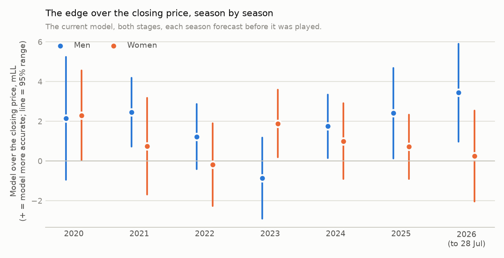
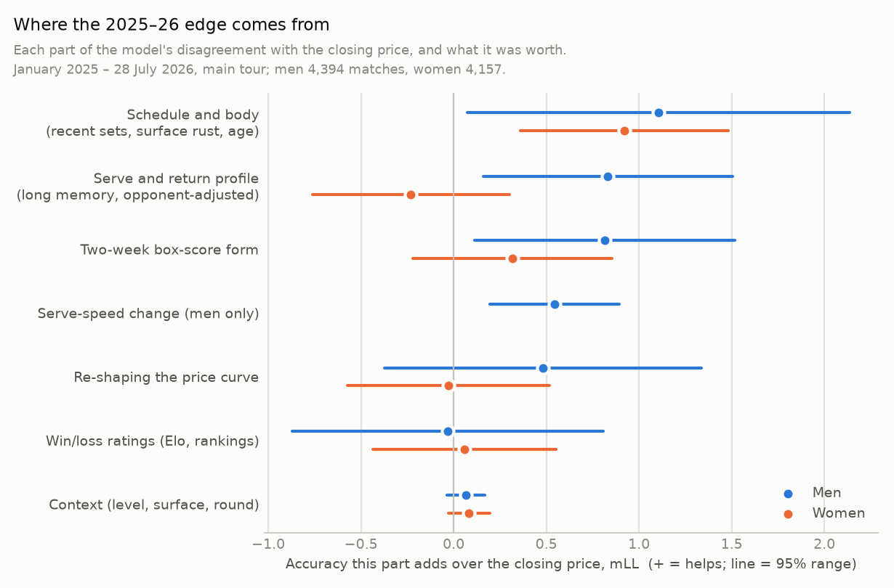
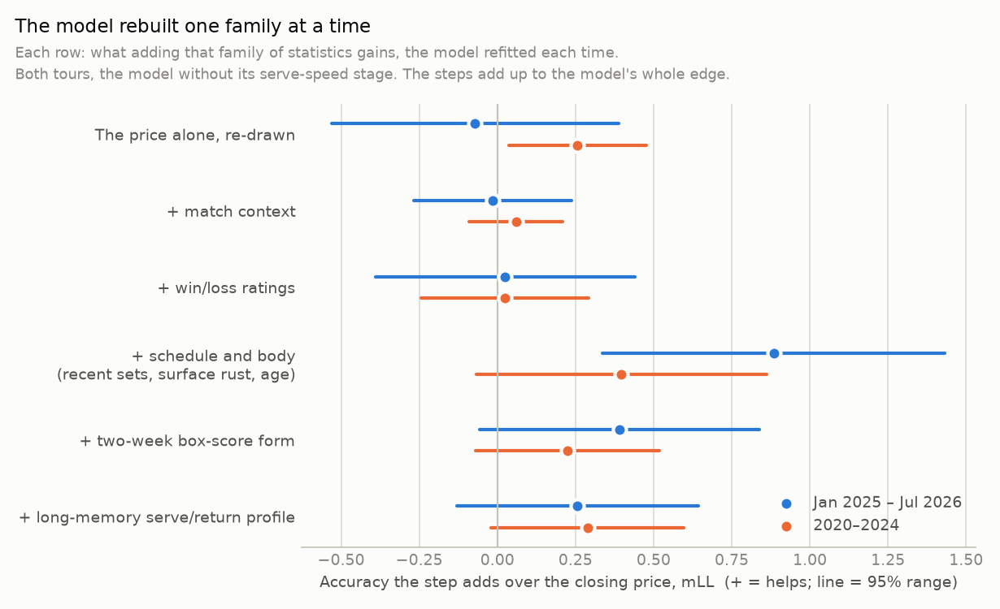

# Where our tennis betting edge comes from, and how to find more of it

12 October 2026 · Written for a business reader with a little statistics, data science and tennis background · Research evidence, not a decision: nothing here changes the model or a stake.

* **The audit trail** is in the [process log](process_log.md).
* **A red team attacked the first draft;** its corrections are folded in ([red team memo](team/red_team.md)).

## 1. The short answer

* **The advice:** "Identify what statistics predict the outcome that the most recent closing line is not pricing in, and build a model around that idea."
* **Our model already works that way, in effect.**
  * Given the closing price and 56 statistics, it starts from the price and adds small nudges where the statistics disagree with it.
  * A plain, transparent "price plus nudges" model built from the same data cannot be told apart from it in 2025–26, and captures about 80% of its edge over 2020–26.
  * Training on recent seasons only does *worse*.
  * **The architecture is not the bottleneck; the information is.**
* **How big the edge is, honestly sized.**
  * Over January 2025 – July 2026 the model beat the closing price by **+1.7** (both tours; men +2.8, women +0.5; units explained in § 2).
  * But these seasons helped choose the model's inputs, so they flatter it. **The better forward estimate is the 2020–26 average: +1.3 (men +1.7, women +0.9).**
  * In backtested money at closing prices, men made about +2% (2020–24) to +5% (2025–26) per unit staked.
* **Men: the edge holds against the sharpest prices.** In 2026 the model beat even the betting exchanges (Betfair and Polymarket). It still beat them when it was fed their price as its own input.
* **Women: unproven since September 2025.**
  * While the model was fed Pinnacle's price, the women's edge stayed at its usual level (+1.3, not yet distinguishable from zero).
  * Since its input switched to BetOnline's line, which for women is much less accurate than the exchanges', it has been about zero.
  * Fed the exchange price in 2026, it adds only +0.3.
* **What the closing price already has, and so is no use to us:**
  * win/loss ratings (Elo, rankings), which add nothing in either period;
  * match context (level, surface, round);
  * a correction to the shape of the price curve, which was worth a little in 2020–24 and is gone.
* **What it still misses, which is where the edge lives:**
  1. **Rhythm, rust and age.** Recent match play helps, time away from the surface hurts, and older players do a little worse than priced.
     * Each effect is small, but each has pointed the same way in nearly every period since 2013, on both tours.
     * Taken out of the model, this family alone costs it +0.63 in 2025–26 and +0.35 in 2020–24, both clearly above zero.
     * It is the one source no other part of the model replaces: the most robust piece of the edge.
  2. **Men: serving against returning.** The market *over*-rates players with strong serving and break-point-saving records and *under*-rates strong returners. This is the strongest single-statistic lead, but it appeared mainly in 2025–26, so it must be confirmed.
  3. **Recent box-score form.** It helped in 2020–24; in 2025–26 most of what it knows overlaps with the serve/return profile.
  4. **Men: changes in serve speed.** Strong in 2025–26, but it cost money in 2023: unstable.
  5. **Women: recent serve form.** The market only partly catches up with it by the close. Not significant once we allow for the number of statistics tested.
* **A better way to find and map the edge: the advice made into a process.**
  * Keep a ledger that sorts every statistic into *priced*, *learned by the close* or *never priced*.
  * **Discover and estimate** over many seasons.
  * **Confirm** on future matches nobody has looked at.
  * Add the winners as small nudges on top of the model.
  * Watch recent seasons for decay.

  In a test whose selection code read no 2025–26 result, choosing statistics this way recovered about 85% of the model's 2025–26 edge (+1.47) with a fifth of its inputs, more than any random set of the same size achieved. Choosing them from the last two seasons alone did worse (+0.84).

## 2. A two-minute primer

**The closing line.** A bookmaker's odds move as money and news arrive. The last price before the match starts, the *close*, is the market's final consensus. At a sharp bookmaker such as Pinnacle it is the best public forecast there is. It works like a stock's closing price: it already reflects what most people know.

**Edge.** Betting makes money only if your probability is more accurate than the price's, by more than the bookmaker's margin. An edge is information the price lacks. "Priced in" means the market already knows it, so it cannot help you.

**How we score accuracy.** We use *log loss*, the standard score for probability forecasts: lower is better.
* A coin flip scores 0.693.
* On the 8,551 main-tour matches of January 2025 to July 2026, the closing price scores 0.5933 and our model 0.5915.
* We quote differences in thousandths, "mLL": +1.7 mLL means the model's average score is 0.0017 better.

It looks tiny because the price already does almost all the work. But edges of this size are what make money against sharp prices: in our backtests, +1 to +3 mLL has gone with about +2% to +5% return per unit staked.

**How we read uncertainty.** Every number comes with a 95% range.
* **The study's main readings,** fixed before any result, are on both tours together, January 2025 to July 2026: the model's edge over the price (§ 3), and how that edge splits across families of statistics when the model is rebuilt one family at a time (§ 5.3). They alone get verdict words:
  * "better" means the whole range is above zero;
  * "unresolved" means the range includes zero, with the probability that the true effect is positive (for example P 0.82).
* **Breakdowns** (men, women, single statistics, other checks) are slices. They get their range and a note when it sits above zero: pointers, not proofs.

**How far the model strays from the market.** Not far.
* Its probability differs from the market's by a median of **1.3 percentage points**.
* It disagrees on who is the favourite in under 3% of matches.

The edge is many small, well-aimed nudges, not bold contrarian calls.

## 3. The scoreboard

Matches from 29 July 2026 are kept sealed for a future untouched test and were not looked at. "Its price" is the model's own input: Pinnacle's closing line until September 2025, BetOnline's after, because Pinnacle's later closes are missing.

*Added 29 Oct 2026:* the owner moved the untouched test of the model's edge to the matches played from 19 Oct 2026, as a soft rule ([decision](../../decisions/2026-10-29-holdout-soft-rule.md)). The five-pattern check had read these matches to 23 Sep, and the P9 study to 18 Oct. Every protected period is now listed in one [register](../../holdouts/README.md).

| | Accuracy over its closing price (mLL, + = model more accurate), Jan 2025 – Jul 2026 | The same, 2020 – Jul 2026 (the better forward estimate) | Money at BetOnline's close, Jan 2025 – Jul 2026 | The same, 2020–24 |
|---|---|---|---|---|
| **Both tours** | **+1.71** [+0.74, +2.68], better | +1.29 [+0.75, +1.84] | +2.0% [−0.9, +5.0] | +1.8% [+0.6, +3.1] |
| Men | +2.83 [+1.27, +4.39] | +1.67 [+0.95, +2.39] | +5.3% [+2.3, +9.8], 1,536 bets | +2.1% [+0.1, +4.2] |
| Women | +0.53 [−0.67, +1.73] (P 0.82) | +0.88 [+0.20, +1.56] | −1.6% [−6.1, +2.0], 1,203 bets | +1.6% [+0.1, +3.1] |

*Money: the owner's staking, every bet with a positive expected edge, archived closing prices (not real fills).*

* **These are backtests, not tests.** The model's inputs, its serve-speed stage and its odds rule were all chosen by studies that had already seen 2025–26. Men's accuracy rose from +1.2 (2020–24) to +2.8 (2025–26), a jump that would happen by chance about 6% of the time, so expect some of it to fall back. The honest check is the sealed matches, from early 2027.
* **The price alone loses money:** betting the price's own small mis-calibrations at BetOnline returns −1.1%. So the profit comes from the model's information.
* **The edge sits where the model disagrees most:** the fifth of matches with the biggest disagreement holds 59% of the gain. That is what any correctly sized set of nudges produces, so it is a consistency check rather than a discovery.
* **It comes more from backing underdogs** (72% of the gain) than favourites. The difference between the two is not yet distinguishable from zero, so this only hints that the edge is not the classic "long-shot bias" correction.
* **Is the yardstick too soft?** From September 2025 the model's price is BetOnline's line. Four checks:
  * **Pinnacle and BetOnline on the same matches (January 2024 – August 2025):** the model beats Pinnacle's close by **+1.44** [+0.23, +2.65] (men +1.90). Against BetOnline it gains about 0.4–0.5 more: BetOnline is a little less sharp.
  * **Men in 2026, against the sharpest closes available:** the model beats the Betfair exchange's close, Polymarket's price 30 minutes before the start, and their average by +3.3 to +4.7. BetOnline's men's line was as sharp as those.
  * **Women in 2026:** the exchanges were far sharper than BetOnline's recorded line (by about 4.5). The model, fed BetOnline's line, finished 3.2 *behind* them. Part of this gap may be timing: BetOnline's "last line" is the last one our data source saw, which can come well before the start.
  * **The decisive test: the model fed the sharpest price.** For 2026 we re-ran the model with the exchange price as its input, its training unchanged.
    * **Men:** it still beat that price by **+3.25** [+0.34, +6.16] (with weekly instead of monthly clustering: [+0.16, +6.34]). The men's model knows things even the sharpest price does not.
    * **Women:** it added only **+0.29** [−2.05, +2.63] (P 0.61).

## 4. Is the model already "built around the closing line"? Yes

The owner's worry was that putting the closing price into a complex non-linear model, trained on more than a decade of matches, might be the wrong way to use it. Four checks say it is not.

1. **The complex model behaves like a simple one.** About 90% of its disagreement with the price is a plain weighted sum of its statistics. The non-linear remainder is worth nothing for men. For women in 2020–24 it hurt slightly (−0.46).
2. **A transparent "price plus nudges" model is close to it, not better.** This model starts exactly at the closing price and adds small, shrunk adjustments from the same statistics.
   * In 2025–26 it scores +1.75 over the price, against the current model's +1.71. The difference, +0.04 [−0.50, +0.57], is indistinguishable from zero.
   * Over 2020–26 it gets +1.04 against +1.29, about 80% of the edge. It trails by 0.25 (P(better) 0.06).
3. **Training on recent seasons only is worse.** Against the same transparent model trained on every season since 2013:
   * the last two seasons only: −1.01 [−1.95, −0.07], worse;
   * the last four: −0.61 [−1.20, −0.03], worse;
   * recent seasons weighted up: −0.33 (P 0.08).

   An earlier study found the same for the main model. The signals are small, so it takes many seasons to measure their size.
4. **The price itself is not where the edge is.** We refitted the model on the price alone, so that it can only re-draw the price's curve:
   * it gets −0.07 in 2025–26, and +0.26 [+0.04, +0.48] in 2020–24;
   * adding match context changes nothing (−0.01, and +0.06 in 2020–24);
   * adding the win/loss ratings changes nothing (+0.02 and +0.02).

**What this means.** "A more sophisticated technique" would not add much on its own. Better *unpriced statistics* would.

## 5. What the 2025–26 close prices, and what it misses

Three views, computed on the same matches (so they are not independent checks of each other):
* each statistic tested on its own against the close, era by era;
* the model's own disagreements taken apart into the families of statistics that drive them;
* the model refitted with each family removed (§ 5.3).

### 5.1 The map

Each statistic is tested at three moments:
* against BetOnline's *opening* line;
* on the *move* from open to close;
* against the *close*.

That sorts it into a kind. The table is generated from the study's ledger (`ledger.csv`).

| Kind | What it means for a bettor | 2025–26 examples |
|---|---|---|
| **Priced** | No use: the price already has it | Most win/loss ratings (men four of five, women three of five; the rest read "mixed" or "learned by the close"); first serves in; most two-week serve and return form for men; most of the long-memory serve/return profile for women |
| **Learned by the close** | Worth something only if you bet early, before the market catches up | Women: the surface part of Elo, two-week points-won form, second-serve form, matches on this surface this season |
| **Partly learned** | The line moves toward it, but not all the way: some edge at any time, more if early | Women: recent aces, first-serve points won, holds, break points saved; rust on the surface; recent match load |
| **Never priced** | A real edge at any betting time: the line does not move toward it | Men: serving strength (holds, break points saved), which is *over*-rated; returning strength, which is *under*-rated; the serve-against-return matchup; recent break points saved (over-rated); serve-speed change |
| **Mixed** | The three moments disagree | Men: rust on the surface, recent match load, age |

*The "opening line" is the first BetOnline line our data source saw, a median 26 hours before the match. Opening lines are soft, so a "move" toward a strength measure partly reflects a soft line catching up, not only the market learning.*

### 5.2 The families inside the model's disagreements

What each part of the model's disagreement with the price was worth in 2025–26 (mLL, + = that part helps). This is a quick look inside the existing model, without refitting it; the refits in § 5.3 are the more faithful test, and where they differ, trust them.

The parts overlap: for men they add up to +3.8 against a total of +2.8. So each is measured three ways, and the table gives the range:
* the gain lost when the part is removed;
* the part refitted without the other families;
* the part on its own.

| Part of the disagreement | Men | Women | Reading |
|---|---|---|---|
| Long-memory serve and return profile (opponent-adjusted, per surface) | **+0.66 to +1.16**, above zero all three ways | −0.23 to +0.20 | Men's strongest family |
| Two-week box-score form | +0.66 to +0.93, above zero two ways of three | −0.25 to +0.32 | Men only |
| Schedule and body: recent sets, days since last on this surface, matches on this surface, age | +0.58 to +1.11, above zero one way of three | **+0.50 to +0.92**, above zero two ways of three | Both tours; confirmed by the refits (§ 5.3), the most robust family |
| Serve-speed change (men only, measured separately) | +0.54 [+0.20, +0.89] | — | Unstable: −1.32 in 2023; about 0 over 2020–26 |
| Re-shaping the price curve | −0.08 to +0.48 | −0.27 to −0.03 | Gone (it was worth +0.26 in 2020–24) |
| Win/loss ratings | −0.07 to −0.01 | +0.05 to +0.27, above zero one way of three | Priced for men; for women perhaps a little (the refitted model agrees: +0.28, P 0.91) |
| Context (level, surface, round) | +0.07 | +0.08 | Priced |

*The chart shows the first of the three measures.*

### 5.3 The model rebuilt one family at a time

The most direct test: refit the model many times, adding one family of statistics at a time (320 more model fits on the GPU). Then check how much each addition improves accuracy over the closing price. This is the study's declared main breakdown, so it gets verdict words for both tours together.

| Family added (in this order) | Both tours, Jan 2025 – Jul 2026 | Both tours, 2020–24 | Men, 2025–26 | Women, 2025–26 |
|---|---|---|---|---|
| The price alone, re-drawn | −0.07, unresolved | **+0.26**, better | −0.01 | −0.14 |
| + match context | −0.01, no detectable addition | +0.06 | −0.11 | +0.08 |
| + win/loss ratings | +0.02, unresolved (P 0.55) | +0.02, no detectable addition | −0.21 | +0.28 (P 0.91) |
| + schedule and body | **+0.88** [+0.34, +1.43], better | +0.40 (P 0.95) | +1.26, range above zero | +0.49 (P 0.93) |
| + two-week box-score form | +0.39 (P 0.96) | +0.22 (P 0.93) | +0.91, range above zero | −0.15 |
| + long-memory serve/return profile | +0.26 (P 0.91) | +0.29 (P 0.97) | +0.54 (P 0.93) | −0.04 |
| **= the model without its speed stage** | **+1.47** | +1.25 | +2.37 | +0.52 |
| + the serve-speed stage (men only) | +0.28 | −0.12 | +0.54 | — |

**Order matters:** a family added earlier gets the credit for what it shares with later ones. So we also refitted the full model with each family taken out. The accuracy lost is what *only* that family knows:

| Family taken out of the full model | Both tours, 2025–26 | Both tours, 2020–24 | Men, 2025–26 | Women, 2025–26 |
|---|---|---|---|---|
| Schedule and body | **+0.63** [+0.19, +1.08], better | **+0.35** [+0.01, +0.69], better | +0.93, range above zero | +0.32 (P 0.80) |
| Long-memory serve/return profile | +0.26 (P 0.91) | +0.29 (P 0.97) | +0.54 (P 0.93) | −0.04 |
| Two-week box-score form | +0.14 (P 0.73) | **+0.30** [+0.05, +0.54], better | +0.44 (P 0.86) | −0.17 |
| Match context | +0.15 (P 0.96) | +0.02 | +0.18 | +0.12 |
| Win/loss ratings | −0.09, no detectable addition | +0.09, no detectable addition | −0.10 | −0.08 |

**Reading.**
* **In 2025–26 the edge is built from player statistics.** Price, context and ratings add nothing; the edge comes from schedule and body, two-week form and the long-memory profile.
* **Schedule and body is the backbone.** It is the one family whose unique part is clearly above zero in both periods. Its single statistics are each too small to pass the multiple-testing correction, but as a family they are the most robust piece of the edge. That is how small, persistent signals behave.
* **The serve/return profile and two-week form overlap.** In 2025–26 the profile carries most of their shared information; in 2020–24 form had its own share.
* **The ratings are priced.** The model loses nothing without them, in either period.
* **The price curve's correction is gone.** It added +0.26 in 2020–24.
* **Men use all three player families. Women use only schedule and body,** and perhaps a little of the ratings.

### 5.4 The statistics in plain words, as hypotheses to confirm

* **Men: the market over-pays for serving and under-pays for returning.** In 2025–26 a man with a strong opponent-adjusted record of holding serve or saving break points does *worse* than the price says, and a strong returner does *better*.
  * Three of these statistics pass the strictest multiple-testing correction we applied.
  * The pattern survives every artefact check run: either odds feed; the Grand Slams left out; an older version of the data built before the latest changes.
  * But it was absent in 2024, and its sign wandered before. **It is the best lead we have, from one window.**
  * One possible mechanism: serving dominance and "clutch" break-point saving are visible and memorable, so bettors pay for them, but they are partly luck; returning skill is less visible.
* **Break points.** For men, high break-point saving has been over-priced in every era since 2013, though only weakly before 2025. For women, the recent version points the *other* way in 2025–26. So "luck read as skill" is a hypothesis, not a finding.
* **Men: serve-speed changes.** A player whose first serve has recently sped up beat the price in 2025–26, and the line did not move toward it. But the same signal cost money in 2023 (−1.32), and it is about zero over 2020–26. **Unstable.**
* **Rhythm, rust and age: the backbone.**
  * Recent match load (more sets in the last two weeks) has pointed the same way in 10 of 10 tour-periods since 2013. Time away from the surface, matches on the surface this season, and age each point the same way in 9 of 10.
  * Each is individually significant in only a few periods. Together they are the family the model can least do without (§ 5.3): a small, persistent effect.
  * One possible mechanism: prices lean on rankings and reputations, which move slowly, while match rhythm and readiness on a surface change week to week.
  * Note that "recent sets" includes this event's sets, so it partly measures how far a player has come through the draw.
* **Women: recent serve form.** Recent aces, first-serve points won and holds beat the price (z about 3), and the market only partly catches up. Not significant after the multiple-testing correction.
* **Women: the edge is unproven, not faded.**
  * While the model was fed Pinnacle's close (to September 2025), the women's edge was +1.3 (P 0.95), the 2020–24 level.
  * After the switch to BetOnline's line it is about −0.6.
  * Fed the sharp exchange price in 2026, it adds +0.3.

  The women's model may have learned a correction to *Pinnacle's* price curve that does not transfer to other books. Pinnacle's own 2025–26 closes would settle it.

## 6. "The most recent closing line": what to take from the word *recent*

The advice can be read two ways, and both matter.
* **The close, not the opening line.** Beat the last price, not an early one. All the scores above are against the close, and the map in § 5.1 shows which statistics are only an early-betting edge.
* **Today's market, not the market of 2015.** Markets learn, so a statistic that once beat the close may now be priced. One example: the model's correction to the shape of the price curve was worth +0.26 in 2020–24 and nothing in 2025 or 2026. It was already gone in 2025, while the input was still mostly Pinnacle's.

**But "recent" should decide *what to watch*, not *what to believe*.** We ran the advice as a process, choosing statistics with code that read no 2025–26 result, then scoring the result on 2025–26. (To be candid: the analyst had already seen the 2025–26 ledger when designing the test, and the candidate statistics themselves were chosen with 2022–26 in view.)

| How the statistics were chosen (each then fitted on every season since 2013) | Accuracy over the close, 2025–26 (mLL) |
|---|---|
| Unpriced over 2013–24 (10 statistics for men, 8 for women) | **+1.47** [+0.67, +2.27]: about 85% of the full model's edge |
| The same, but also required to hold in 2023–24 | +0.89: worse by 0.58 [0.20, 0.96]. The filter threw out serve speed and women's recent aces, two of 2025–26's strongest |
| Unpriced in 2023–24 only, the same number of statistics | +0.84 [+0.35, +1.34]: the 2013–24 rule is ahead by +0.63 (P 0.97) |
| Unpriced in 2023–24 only, strict threshold (3–4 statistics) | +0.00 |
| 60 random sets of the same size | median +0.57; the best +1.15, below +1.47 |
| Any rule, fitted on the last four seasons only | worse than fitted on all seasons |

**The rule that works:** discover and estimate over many seasons. Confirm on future matches nobody has looked at. Use recent seasons to watch for decay, not to veto.

## 7. What a model built around the advice could look like

Three agents brainstormed this independently: a betting-market practitioner, a statistics and machine-learning architect, and a tennis-signal scout. Each was briefed before any of the results above existed, and none was given them. A fourth agent, a red team, then attacked the diagnosis and re-derived its numbers. Their memos are in [team/](team/).

Their proposals, combined with the results, give this design:
1. **The anchor: the sharpest closing price.** Start every forecast at Pinnacle's margin-free price, and calibrate each bookmaker's line separately, because the books differ in sharpness (for women in 2026, a lot).
2. **The residual learner: the current model, unchanged.** It is the best tool we have tested for estimating the small nudges, and it needs the decade of data because each nudge is tiny.
3. **The signal ledger: the advice made into a routine.** For every statistic we hold or build, the three-moment test of § 5.1 (opening line, move, close), re-run regularly with its trend over the years. A statistic sliding toward "priced" is an edge being competed away.
4. **The admission route for new statistics.**
   * Discover candidates and estimate their size over many seasons.
   * Add them as small, shrunk nudges on top of the model, as serve speed is today.
   * Confirm them on matches nobody has looked at.
   * Only then offer them to the main model at its next rebuild.

   The main model uses sparse signals poorly: given serve speed as an input, it captured only 8% of its value; as a separate nudge, it gains +0.41.
5. **The monitor.**
   * How much of each family's disagreement comes true, season by season.
   * The closing-line value of every real bet.
   * An alarm when a family's nudges stop coming true.
6. **Bet timing by kind.**
   * Signals the market learns by the close pay only to early bettors; on Polymarket the model's edge was largest 24–48 hours out in an earlier study.
   * Signals it never learns pay at any time, so bet where the price and the limits are best.

**The practitioner's frame: two businesses.** The advice hides two ways to make money:
* **Beat the close:** find information the sharpest closing price never contains, and bet at any time. It is scored by results, which is slow: about 9,000 men's matches to confirm an edge of this model's size.
* **Beat the move:** find information the market *will* price by the close but has not yet, and bet early. It is scored by closing-line value, which is fast: about fifteen times fewer bets are needed than for profit.

The current model is built for the first. The practitioner's inference is that most professional money is made in the second. The map in § 5.1 says which statistics belong to which business.

**What the team proposed, and what the numbers then said:**

| Proposal | Who | What the data says now |
|---|---|---|
| Re-score the edge against the sharpest close, not the model's own input | Practitioner #1 | Done (§ 3). Men: the edge holds, even when the model is fed the sharpest price. Women: behind the exchanges in 2026 |
| A "move scan": which statistics the market learns between open and close | Practitioner #3 | Done (§ 5.1 and the appendix) |
| Re-size each family's nudges as it proves under- or over-used (a "brake") | Architect, practitioner #4 | Tested walk-forward: no gain (men −0.16; worse in 2023). Re-weighting what the model already knows is worth at most about 0.3 mLL. Keep it as a monitor only |
| A transparent "price + nudges" model instead of the current one | Architect; an earlier study | Close to it (80% of the edge over 2020–26), not better: a glass-box companion that explains each bet, not a replacement |
| Choose statistics by their recent performance against the close | The advice, read literally | Worse than choosing over many seasons (§ 6) |
| Extend serve speed: second serve, faults, the fade within a match, daily data | Scout #1 | The base signal is unstable (§ 5.4); the extensions are untested |
| Players arriving from lower levels (Challengers, ITF) | Scout #2 | The close under-rated them more each era to 2024; untested on 2025–26 |
| Rhythm at the new 12-day events: a seed's first-round bye against an opponent who has already played there | Scout #3 | Fits the persistent "recent sets" signal; untested |
| BetOnline's close keeps more crowd over-reaction than Pinnacle's | Scout #4 | On the same matches the model gains about 0.4–0.5 more against BetOnline than against Pinnacle |
| Record prices continuously and log every bet's closing-line value | Practitioner #2 | Not built. The Pinnacle recorder exists but has run three times; `data/betting_history/` is empty |
| Follow the early money of Polymarket's consistently winning accounts | Practitioner #6 | Untested; a timing edge |
| Challengers at Polymarket | Practitioner #7 | Untested; the softest liquid tennis market, but thin early and only one season of prices |
| Settle each venue's bets by its own rules (Polymarket pays a retirement to the player who goes through) | Practitioner #8 | An accounting fix for any Polymarket backtest |
| Pre-register the leads and read them once, on the sealed matches | Red team | Recommended (§ 8) |

## 8. What we recommend

Ranked. Each says what it rests on and what happens on a yes. Accepting any of them is the owner's call.

1. **Keep the model as built. Spend the effort on information, not architecture.**
   * The transparent alternative gets about 80% of the edge.
   * Recent-only training is worse.
   * Re-sizing the model's nudges did not help.
   * The non-linear part is worth nothing.
2. **Pre-register five leads now, and read them once on the sealed matches** (about 5,000 matches, early 2027), as bundles, not one statistic at a time:
   * the men's serve-against-return cluster;
   * men's serve-speed change;
   * recent match load, both tours;
   * time away from the surface, both tours;
   * women's recent serve form.

   *On a yes:* I write the pre-registration (signs, the one look date, the decision rule) and hash it before any sealed result exists.
3. **Obtain Pinnacle's closes from August 2025.** Paid sources exist (see the early-lines research). This one purchase settles three questions: whether the women's edge is real, how the 2026 numbers compare with the sharpest price, and the retraining on Pinnacle that is already decided.
4. **Women: do not bet the women's model off BetOnline's line.**
   * Bet women only with Pinnacle's live price as the input (the production rule), at small stakes, until item 3 settles the question.
   * The women's lower-level data lost after June 2026 should be repaired first (the scout's warning).
5. **Run the advice as a standing ledger,** every quarter: § 5.1's three-moment map for every statistic we hold, with its trend.
   * A quarter cannot admit or drop a single statistic: one tour-season resolves only about 1.5 mLL. Use the ledger to watch for decay, and to pick what to pre-register.
   * *On a yes:* I turn this study's scan, line-move and ledger code into one command over the whole pool of 606 candidate columns.
6. **Build next, in this order,** each then pre-registered and confirmed on unseen matches:
   1. *Rhythm and rust,* the backbone of the edge. Richer versions of what already works:
      * rhythm at the 12-day events (the scout's #3);
      * qualifiers' match load;
      * rest measured in hours;
      * time away from the surface;
      * age against the player's own career curve.
   2. *Men's returning against serving, and break-point luck.* Two statistics: return quality against the server's norm, and break points saved beyond what the player's serve points won imply.
   3. *Serve-speed extensions* (the scout's #1).
   4. *Players arriving from lower levels* (the scout's #2).
7. **Start keeping score the professional way.**
   * Schedule the Pinnacle price recorder.
   * Log every real bet with its price, time, venue, stake and Pinnacle's closing price.
   * Track closing-line value weekly. It confirms or kills an edge about fifteen times faster than profit.
   * *On a yes:* I schedule the recorder and set up the bet log.
8. **Keep the transparent model as a glass-box companion.** For each bet it says which statistics drive the disagreement. That makes the bets explainable, and it shows decay early.

## 9. What this does not show

* **No untouched test.** The 2025–26 numbers are in-sample for the choice of the model's inputs, its serve-speed stage and its odds rule. The process test of § 6 is clean in its selection code only. The sealed matches from 29 July 2026 are the honest check.
* **Archived closing prices, not real bets.** No betting limits, delays or account restrictions are in the data.
* **The 2026 benchmark.** Pinnacle's 2026 closes are missing. The exchange prices are timed differently from the bookmakers' (Betfair's close is untimed; Polymarket's is 30 minutes before the listed start).
* **Many statistics were tested.** With the small-sample correction (t-based p-values, about 21 four-week blocks), four men's statistics pass a 5% false-discovery rate: serving holds, serving break points saved, serve-speed change, returning on the first serve. Three more pass 10%. No women's statistic passes 5%. The rhythm and rust items rest on two other legs: their consistency across 2013–24, and the refits, where their family is the one whose unique part clears zero in both periods (§ 5.3).
* **The mechanisms are hypotheses.** Nothing here proves *why* the market misses these statistics.

## Appendix: the statistic ledger, 2025–26

The statistics that most clearly beat or lose to the closing price.

How to read the columns:
* **z:** how many standard errors the effect sits from zero. Beyond ±2 is notable.
* **q:** the false-discovery rate with the small-sample correction. Roughly, the share of statistics this strong that would be flukes, given how many were tested.
* **Open / move / close:** the same z at BetOnline's opening line, on the move from open to close, and at BetOnline's close. A large "move" means the line catches up before the match.

| Tour | Statistic (player A minus player B) | 2025–26: the player higher on it… | z, 2025–26 | q | z, 2013–24 | Open / move / close | Kind |
|---|---|---|---:|---:|---:|---|---|
| Men | Long-memory serving: service games held | loses to the price | −4.4 | 0.01 | −1.1 | −3.7 / +1.1 / −3.4 | never priced |
| Men | Long-memory serving: break points saved | loses to the price | −3.9 | 0.02 | −1.6 | −3.5 / −1.0 / −3.2 | never priced |
| Men | Recent change in first-serve speed | beats the price | +3.8 | 0.02 | +2.7 | +3.5 / +1.8 / +3.4 | never priced |
| Men | Long-memory returning: holding the server's first-serve points down | beats the price | +3.3 | 0.05 | +0.9 | +3.1 / +0.3 / +3.2 | never priced |
| Men | Matchup, my serve against your return: break points saved | beats the price | +2.9 | 0.08 | +0.4 | +2.3 / −1.7 / +2.4 | never priced |
| Men | Matchup, my serve against your return: service games held | beats the price | +2.9 | 0.08 | +0.7 | +2.2 / −1.0 / +2.2 | never priced |
| Men | Two-week form: break points saved | loses to the price | −2.8 | 0.08 | −2.3 | −2.7 / +1.6 / −2.8 | never priced |
| Men | Days since the last match on this surface | loses to the price | −2.5 | 0.11 | −1.6 | −1.8 / −3.0 / −1.5 | mixed |
| Men | Sets played in the last 14 days | beats the price | +2.0 | 0.15 | +3.5 | +1.8 / +0.7 / +1.7 | mixed |
| Men | Age | loses to the price | −2.0 | 0.15 | −3.3 | −1.1 / −1.0 / −1.1 | mixed |
| Women | Two-week form: aces | beats the price | +3.3 | 0.06 | +2.4 | +3.3 / +3.1 / +3.1 | partly learned by the close |
| Women | Two-week form: first-serve points won | beats the price | +3.3 | 0.06 | +1.9 | +3.3 / +4.9 / +2.9 | partly learned by the close |
| Women | Days since the last match on this surface | loses to the price | −3.3 | 0.06 | −3.0 | −2.6 / −4.1 / −2.2 | partly learned by the close |
| Women | Two-week form: break points saved | beats the price | +3.0 | 0.09 | −1.1 | +3.7 / +3.2 / +3.4 | partly learned by the close |
| Women | Two-week form: service games held | beats the price | +2.8 | 0.11 | +0.7 | +3.6 / +5.5 / +3.0 | partly learned by the close |
| Women | Sets played in the last 14 days | beats the price | +2.6 | 0.14 | +4.0 | +2.3 / +3.0 / +2.0 | partly learned by the close |

In effect priced, and not in the table: every win/loss rating (Elo, surface Elo, ranking points, the serve/return rating matchup). The full ledger, every statistic and both tours, is `data/studies/edge_anatomy/ledger.csv`.

## Glossary

* **Closing line (close):** the last price before the match starts.
* **Margin-free price:** the bookmaker's odds with its profit margin removed, read as a probability.
* **Log loss, mLL:** the accuracy score for probabilities (lower is better); mLL is a difference in thousandths.
* **Priced in:** already reflected in the price.
* **Opening line:** the first price a bookmaker posts; here, the first BetOnline line our data source saw, a median 26 hours before the match.
* **Closing-line value (CLV):** how much better your bet's price was than the close; the professional's day-to-day scorecard.
* **IOS profile:** each player's serve and return strength statistic by statistic, adjusted for the opponents faced and for surface.
* **Overfitting:** a model memorising noise in its training data; the reason small samples mislead.
* **Sealed matches:** matches played since 29 July 2026, whose results no study has looked at; kept for an honest test.

## Files

| What | Where |
|---|---|
| The audit trail: request, plan, every look at results, corrections | [process_log.md](process_log.md) |
| The team's memos and their briefs | [team/](team/), [briefs/](briefs/) |
| Code | `src/eda/edge_anatomy/` |
| Results (CSV) | `data/studies/edge_anatomy/` |
