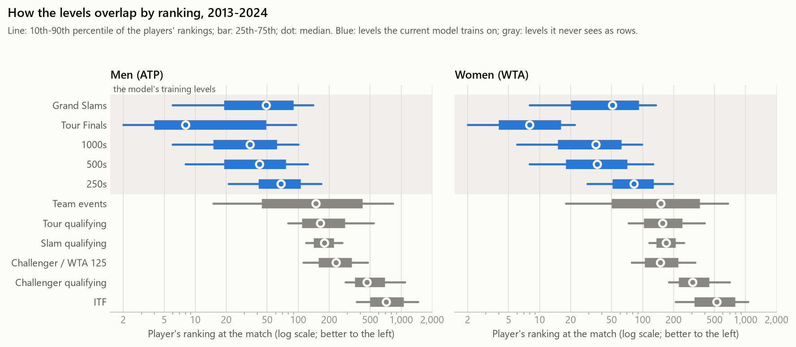
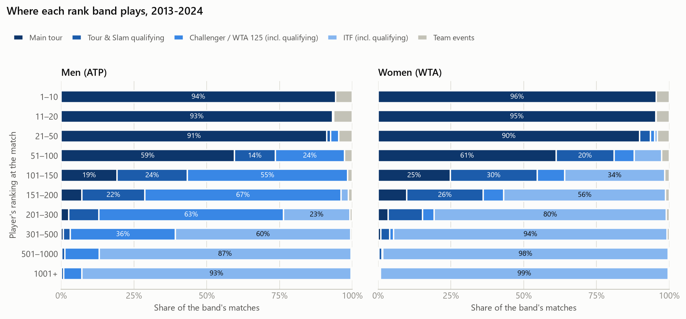
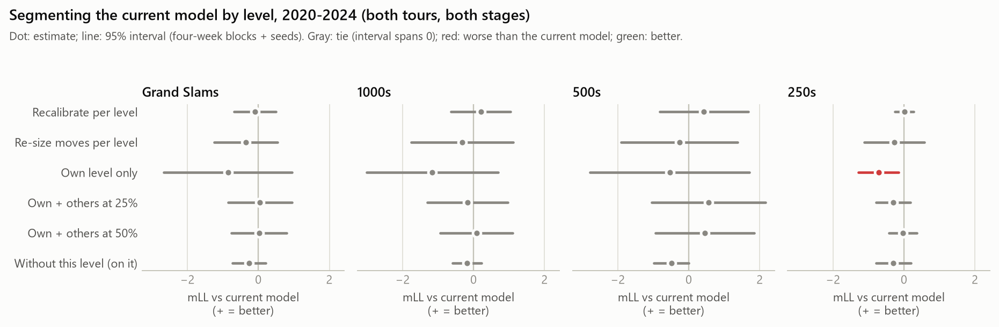

# How the tournament levels blend, and should the model be split by level?

8 October 2026 · Written for the owner · Research evidence, not a decision.

**The owner's questions.**
* The current best model is built mostly from 250-and-above events, isn't it?
* Is each event useful?
* Should each level learn mainly from its own level, with the other levels pooled in at a lower weight?
* More rows and different statistics are arriving for lower-level events. Could they hurt the model, or do they deserve a separate model if they are to be bet?
* How do the levels blend into each other by ranking, and how does that affect the data?

**Ground rules.**
* Every result that reads a match outcome uses seasons 2013–2024 only. 2025–2026 is the [proposed clean holdout](../clean_holdout_rebuild/README.md) and is not read.
* Everything runs on the snapshot the model frame was built on (the 30 September Stage 0, kept by the 7 October rebuild). The model's 55,144 matches of 2013–2024 were rebuilt here and match the model frame value for value on all 58 inputs.
* Units: mLL = milli-log-loss per match. **+ = the named version is better.** A 95% interval spanning 0 is a tie. Each experiment's reading rule was written before that experiment was scored; the exploratory additions record when they were added (`data/studies/event_levels/reading_rules.md`).

## The answer in short

* **Built mostly from 250-and-above events? Yes, entirely.** Every training row is a main-tour match, because a row needs a closing price; 250s are 40% of them. Lower levels never become rows, but they fill the players' histories behind the features: before a 250 match, 44% of a man's and 50% of a woman's matches in the previous year were below the main tour.
* **Is each event useful? Every main-tour level helps a little; none is indispensable.** Leaving a whole level out of training costs 0.2–0.5 mLL on its own matches and up to 0.24 on the others (all ties): the remaining levels fill in. For betting, the model's edge over the close sits at the Slams (+2.4) and 250s (+1.3); the 1000s and 500s tie.
* **Should each level learn from its own level, with the others down-weighted? No.** Training on one level only leans worse at every level and is significantly worse at the 250s. Thinning the other levels to 25% or 50% ties everywhere; so does recalibrating per level. A level's own rows are worth no more than the same number of mixed rows. TabPFN already uses its `level` input.
* **Could lower-level rows hurt the model? Added as training rows, they don't help and lean harmful.** With every Challenger match added (price missing), the current model scores −0.48 [−1.09, +0.14] on the main tour, a tie but negative in every season, and its edge over the close becomes a tie. Their value is in the players' histories, where they already are.
* **A separate model if they are bet? For Challengers a model is easy; an edge is unmeasured.** Every input exists for Challenger matches, and a model trained on the main tour forecasts them about as well as one trained on them (pooled and separate tie). Polymarket's Challenger markets are liquid (median $68,000 per match). But no Challenger price before September 2025 is in hand to test an edge against, and integrity alerts concentrate at that level. ITF has results-only history before 2025 and thin markets.
* **How the levels blend.** The rungs overlap: players ranked about 50–200 split their weeks among 250s, qualifying and Challengers. The same players win 61% of their matches at Challengers and 37% on the main tour, so raw statistics are not comparable across levels. The model's inputs are opponent-adjusted, with one exception (`points_52w`). Elo is about right across levels. The closing price under-rates players arriving from lower levels (replicated on 2013–2019), but on the main tour it is worth about 0.1 mLL and ties as an input.

## 1. What the model trains on today

**Yes: only main-tour matches, and 250s are the largest group.** A training row needs a closing price, and the price source (tennis-data.co.uk) covers only the Slams, Tour Finals, 1000s, 500s and 250s.

| Level | Model rows, 2013–2024 | Share |
|---|---|---|
| 250s | 22,203 | 40.3% |
| 1000s | 12,463 | 22.6% |
| Grand Slams | 11,373 | 20.6% |
| 500s | 8,671 | 15.7% |
| Tour Finals | 434 | 0.8% |
| **All** | **55,144** | |

* Men and women are pooled, with a tour column: 27,289 men's and 27,855 women's matches. Men's 2018 has no prices, so it is missing.
* The 2024 fit trains on 50,003 matches; the live 2026 fit on 60,249.
* `level` (Slam, Finals, 1000, 500, 250) is already one of the 58 inputs, so TabPFN can treat the levels differently when the data say so.

**Lower levels already reach the model, through the players' histories.** Elo, the serve and return ratings, the IOS profile and the short-memory form are built from every singles match since 2010, every level included. In 2013–2024 the Stage 0 table has, besides the main tour:

| Never a training row | Matches, 2013–2024 | In the features' history? |
|---|---|---|
| ITF main draws | 389,850 | Yes. Results only before 2025: no ITF box score exists before then |
| ITF qualifying | 69,521 | Yes (results only) |
| Challenger / WTA 125 main draws | 66,126 | Yes, with box scores (men ~100%, WTA 125 74–97%) |
| Tour qualifying | 24,009 | Yes |
| Challenger qualifying | 22,914 | Yes |
| Slam qualifying | 9,613 | Yes |
| Team events | 6,302 | Yes |

## 2. How the levels blend by ranking



**The rungs overlap, they are not stacked.** Players' ranking at the match, 2013–2024:

| Level | Men: median (10th–90th) | Women: median (10th–90th) |
|---|---|---|
| Grand Slams | 49 (6–139) | 51 (8–135) |
| 1000s | 34 (6–100) | 35 (6–98) |
| 500s | 42 (8–124) | 36 (8–126) |
| 250s | 68 (21–168) | 82 (29–196) |
| Tour qualifying | 164 (80–538) | 156 (73–400) |
| Slam qualifying | 180 (119–267) | 169 (116–253) |
| Challenger / WTA 125 | 233 (112–475) | 149 (78–325) |
| Challenger qualifying | 464 (286–1,091) | 305 (179–702) |
| ITF | 718 (368–1,462) | 526 (209–1,055) |

* **The 250s reach furthest down.** The weaker player in a men's 250 match has a median ranking of 95; the stronger player in a Challenger match, 173. A quarter of the players in men's Challenger matches are ranked better than 158; a quarter of those in men's 250 matches are ranked worse than 105.
* **The women's second tier is thin.** The WTA 125s draw a field ranked about like the men's qualifying (median 149), and there are few of them (4,847 matches in 12 years against the men's 61,279 Challengers). Women ranked 101–150 play a third of their matches at ITF level, and those ranked 151–300 most of them.



**Players ranked about 50–200 live on two or three levels at once.**

| Ranking | Men | Women |
|---|---|---|
| 51–100 | 59% main tour, 14% qualifying, 24% Challenger | 61% main tour, 20% qualifying, 7% WTA 125, 9% ITF |
| 101–150 | 19% main tour, 24% qualifying, 55% Challenger | 25% main tour, 30% qualifying, 9% WTA 125, 34% ITF |
| 151–200 | 7% main tour, 22% qualifying, 67% Challenger | 10% main tour, 26% qualifying, 7% WTA 125, 56% ITF |

* **They move every few weeks.** After a Challenger, men ranked 51–100 play their next event on the main tour 54% of the time. After a main-tour event, men ranked 101–150 go back to a Challenger 37% of the time and to qualifying 20% (`blend/moves.csv`).
* **So the rating graph is well connected.** In 92% of men's 250 matches at least one player played a Challenger in the previous year; in 47% the two players' "home tiers" (where most of their last year was played) differ.

## 3. What that does to the data

### A main-tour match's history is largely lower-level

Each player's matches in the 365 days before the match, by tier. Player-weighted means, 2013–2024:

| Match level | Men: main tour / qualifying / Challenger / ITF | Women: main tour / qualifying / WTA 125 / ITF |
|---|---|---|
| Grand Slams | 64% / 9% / 22% / 2% | 66% / 13% / 4% / 15% |
| 1000s | 75% / 7% / 14% / 1% | 76% / 9% / 3% / 8% |
| 500s | 69% / 8% / 18% / 1% | 74% / 10% / 3% / 10% |
| **250s** | **54% / 12% / 29% / 3%** | **48% / 18% / 5% / 26%** |

* At the 250s, 41% of men and 48% of women had most of their previous year below the main tour.
* **For women the gap is in the statistics, not the results.** ITF matches have no box score before 2025, so a quarter of a women's 250 player's year adds to Elo but nothing to the box-score inputs (IOS, form, the serve and return ratings).

### The same player's statistics change with the level

The same players in the same season, at a Challenger (or WTA 125) and on the main tour, at least three box scores at each (`blend/level_shift.csv`):

| | Men (1,719 player-seasons) | Women (756) |
|---|---|---|
| Total points won | 48.5% → 51.3% (**+2.9 points**) | 48.4% → 50.8% (+2.4) |
| Service games held | +3.6 points | +3.8 |
| Return games broken | +8.3 points | +6.8 |
| Matches won | 37% → 61% | 38% → 56% |
| Opponents' median ranking | 64 → 212 | 76 → 153 |

Qualifying shows the same shift (men +2.8 points of total points won).

* **A raw statistic is not comparable across levels.** The same players win 61% of their matches instead of 37%, because they face players ranked about 210 instead of 64.
* **The model's inputs are almost all opponent-adjusted**, so the level mix should wash out: Elo, the serve and return ratings, games-weighted Elo, the IOS profile and the adjusted short-memory form all measure performance against the opponents faced.
* **One input is not:** `points_52w`, the serve-against-return points matchup over the last 52 weeks, uses raw rates (Stage 4's "52 weeks" form; its "adjusted" form is a different column, not in the model). A Challenger-heavy year inflates it.

### Data held differs by level

| Level | Box score, 2019–24 | Box score, 2025–26 | Point-by-point, 2018–24 |
|---|---|---|---|
| Main tour | 96–100% | 87–100% (Roland Garros 2026 has none in this snapshot) | 84–99% |
| Men's Challengers | 100% | 100% | 41% |
| WTA 125 | 97% | 100% | 88% |
| ITF | 0% | 96% | ~0% |

Box scores from Stage 0; point-level shares from the data map's coverage cells (data held, not results).

### Elo across levels

Stage 1's Elo runs over every level with one K schedule: a Challenger win moves a rating as much as a Slam win.

* **Its scale differs by level.** Logistic slope of the result on Elo's log-odds (1 = right-sized), 2013–2024, in-sample: men's Slams 1.20 (Elo too timid: best of five favours the stronger player), 1000s 0.85, 500s 0.88, 250s 0.80, Challengers 0.89; women 0.88–1.07.
* **Players arriving from lower levels are rated about right.** With each level's slope fitted beside it, A's minus B's share of last year's matches below the main tour adds little: men +0.11 [+0.02, +0.20] on the main tour (500s +0.26 [+0.06, +0.47], the other levels tie), women +0.09, a tie. In mixed matchups at the men's main tour, the Challenger-based player beats calibrated Elo by +1.0 point of win probability [−0.1, +2.0], a tie.
* **At the Challengers**, ITF-based players do worse than calibrated Elo by 1.2 points [0.4, 2.1], and main-tour players dropping down by 1.4 [−0.1, 2.8], a tie.

## 4. Should each level learn mainly from its own level? (experiment A)

**The test.** The current model, refitted with only its training rows changed, for each target level L:
* **own level only:** L's matches;
* **others at 25% / 50%:** all of L's matches plus each other match kept with probability 0.25 or 0.5. TabPFN takes no sample weights, so a lower weight is a thinner sample (a new draw per seed);
* **size control:** a random draw of every level, as many matches as "own level only" has;
* **without this level:** every level except L.

Seasons 2020–2024 scored (2019 calibrates), four seeds, 480 new fits. Every version gets both stages, its stage 2 fitted on L's matches. It is compared with the current model as decided, and with the current model recalibrated on L's matches alone.



Both tours, 2020–2024, on each target level's matches; + = the named version beats the current model (`results.csv`, part 2):

| Target level | Own level only | Others at 25% | Others at 50% | Recalibrated per level | Moves re-sized per level |
|---|---|---|---|---|---|
| Grand Slams | −0.86 [−2.66, +0.95] tie | +0.04 [−0.85, +0.94] tie | +0.02 [−0.76, +0.80] tie | −0.10 [−0.69, +0.49] tie | −0.35 [−1.24, +0.55] tie |
| 1000s | −1.16 [−3.02, +0.69] tie | −0.17 [−1.30, +0.96] tie | +0.08 [−0.93, +1.10] tie | +0.20 [−0.64, +1.05] tie | −0.32 [−1.75, +1.11] tie |
| 500s | −0.54 [−2.79, +1.71] tie | +0.56 [−1.05, +2.16] tie | +0.46 [−0.94, +1.85] tie | +0.42 [−0.82, +1.67] tie | −0.26 [−1.90, +1.38] tie |
| 250s | **−0.71 [−1.28, −0.15] worse** | −0.30 [−0.78, +0.18] tie | −0.02 [−0.42, +0.37] tie | +0.01 [−0.25, +0.27] tie | −0.27 [−1.11, +0.57] tie |

* **Nothing beats pooling.** No version is better than the current model at any level.
* **Own level only is the worst option.** It is worse in direction at all four levels, significantly at the 250s. It is worse in both 2020–21 and 2022–24 at the 1000s (−2.01, −0.87), 500s (−0.58, −0.52) and 250s (−1.18, −0.48); the Slams flip (+0.51, −1.66).
* **Down-weighting the other levels is a wash.** At 25% or 50% every result ties; the 500s lean positive in both eras (+0.3 to +0.8), within noise.
* **Level-specific calibration adds nothing.** Recalibrating stage 2 per level, or re-sizing the move away from the close per level (exploratory, prompted by section 5's realisation pattern), ties everywhere.

**Is each level useful?** Rows left out, and a level's own rows against the same number of mixed rows:

| Level left out | On its own matches | On the other levels' | Own rows vs a same-size mixed draw |
|---|---|---|---|
| Grand Slams | −0.26 [−0.73, +0.21] tie | +0.02 [−0.30, +0.34] tie | −0.37 [−2.28, +1.55] tie |
| 1000s | −0.19 [−0.59, +0.22] tie | −0.17 [−0.41, +0.07] tie | **−1.65 [−3.30, −0.01] worse** |
| 500s | −0.49 [−0.98, 0.00] tie | −0.17 [−0.37, +0.03] tie | −0.01 [−2.04, +2.03] tie |
| 250s | −0.30 [−0.79, +0.19] tie | −0.24 [−0.62, +0.14] tie | −0.56 [−1.37, +0.24] tie |

* **Every level helps a little, none is indispensable.** Leaving a level out costs its own matches 0.2–0.5 mLL and the other levels up to 0.24 (seven of eight estimates negative, all ties). The other levels fill in for a missing one almost completely.
* The 1000s' rows help the 250s: −0.37 [−0.72, −0.03] without them.
* **A level's own rows are worth no more than mixed rows.** At equal size, own-level rows lose in direction at all four levels, clearly at the 1000s.
* **Reading.** With `level` and `best_of` among its inputs, TabPFN already uses the other levels as context where they help. Splitting the data only removes rows that carry information. The rule written beforehand (a version must beat both the current model and its per-level recalibration) is met nowhere.

## 5. Where the current model's edge is, by level

The current model (both stages, as decided) against the books' average close, recalibrated as decided, and against Pinnacle. 2020–2024, debut seasons out (`by_level.csv`, `results.csv` part 1).

| Level | Matches | vs average close | vs Pinnacle | Realisation vs close |
|---|---|---|---|---|
| **All levels** | 22,265 | **+1.28 [+0.58, +1.97] better** | **+0.94 [+0.22, +1.66] better** | 1.10 |
| Grand Slams | 4,795 | **+2.42 [+1.25, +3.59] better** | +1.25 [−0.24, +2.75] tie | 1.54 |
| 1000s | 5,048 | +0.71 [−0.86, +2.28] tie | +0.87 [−0.58, +2.32] tie | 0.84 |
| 500s | 3,639 | +0.59 [−0.87, +2.05] tie | +0.35 [−1.17, +1.87] tie | 0.79 |
| 250s | 8,633 | **+1.34 [+0.10, +2.58] better** | +1.12 [−0.16, +2.39] tie | 1.16 |
| Tour Finals | 150 | −3.03 [−8.16, +2.09] tie | −2.28 tie | (too few) |

* The all-levels row equals the [training-window study](../training_window/README.md)'s published figure exactly (+1.28 and +0.94), so this harness reproduces it.
* **Realisation:** 1 = the model's moves away from the close are right-sized; above 1 = not far enough; below 1 = too far. At the Slams the model moves too little (1.54, SE 0.26); at the 1000s and 500s a little too far (0.84, 0.79).
* **By tour, at the Slams:** men +3.00 [+1.07, +4.93] better than the close and +2.01 [+0.01, +4.01] better than Pinnacle; women +1.84 [+0.31, +3.37] better than the close, tie against Pinnacle.
* **At the 250s:** men +1.62 [+0.05, +3.18] better than the close; women +0.99, a tie.
* **Every level's interval overlaps every other's.** The pattern (Slams and 250s carry the edge, 1000s and 500s tie) is suggestive, not established.
* **The close itself is not equally calibrated everywhere.** With the decided per-tour recalibration, its slope on the result (1 = right) is 1.09 (SE 0.05) at the men's Slams (favourites underpriced), and, both tours, 0.95 (SE 0.02) at the 1000s, 1.06 (SE 0.04) at the 500s and 0.97 (SE 0.03) at the 250s. This matches the literature (section 9): the favourite–longshot bias is larger at Slams.

## 6. Lower-level rows: do they hurt the model, and do they need their own? (experiment B)

**The test.** The extended frame's main-tour matches and its Challenger matches (men's Challengers and WTA 125 main draws, 66,126 in 2013–2024), with the same 58 inputs. Four training sets:
* **main tour only, no price (`nmt`):** the current model without its closing price (57 inputs);
* **Challengers only, no price (`nch`):** a separate Challenger model;
* **both pooled, no price (`nmtch`);**
* **the current model plus every Challenger match (`omtch`):** the 58 inputs, with the price missing on Challenger rows (none exists).

Seasons 2022–2024 scored (2021 calibrates), seeds 0–1, 32 new fits of up to 108,653 rows. Every fit forecasts every main-tour and Challenger match of its season. The no-price versions get one slope per tour, fitted on the same population's matches of 2021 .. Y − 1. `omtch` and the current model (same seeds, same window) get both stages.

**Do Challenger rows hurt the current model?** On main-tour matches, 2022–2024:

| | Both tours | Men | Women |
|---|---|---|---|
| Current model + Challenger rows, vs the current model (both stages) | −0.48 [−1.09, +0.14] tie | −0.91 [−1.89, +0.08] tie | −0.01 [−0.62, +0.61] tie |
| Without prices: + Challenger rows, vs main tour only | +0.03 [−0.39, +0.45] tie | −0.24 [−0.81, +0.33] tie | +0.32 [−0.31, +0.95] tie |
| Without prices: Challengers only, vs main tour only | **−1.21 [−2.05, −0.36] worse** | **−2.08 [−3.34, −0.81] worse** | −0.25 [−1.44, +0.93] tie |

* **No detectable harm, and no help.** With the price in, the Challenger rows lean worse in every season (−0.52, −0.73, −0.18), and the model's edge over the close falls from +0.93 [+0.09, +1.76] (better) to +0.45 [−0.65, +1.55] (a tie), both on B's two seeds and calibration window.
* **The likely mechanism (inferred):** with 45,000–59,000 rows that have no price in its context, the model leans harder on the features and moves further from the close: its realisation against the close falls from 0.91 to 0.63 (below 1 = too far).
* Without prices, adding Challengers changes nothing on the main tour.

**Do Challengers need their own model?** On Challenger matches, 2022–2024, no prices:

| | Both tours | Men | Women |
|---|---|---|---|
| Challengers only, vs main tour only | +0.44 [−0.14, +1.02] tie | **+0.79 [+0.19, +1.38] better** | −1.81 [−4.05, +0.44] tie |
| Pooled, vs Challengers only | +0.17 [−0.15, +0.49] tie | +0.04 [−0.26, +0.35] tie | +1.02 [−0.26, +2.30] tie |
| Challengers only, vs Elo | **+11.58 [+8.89, +14.27] better** | **+12.42 [+9.71, +15.14] better** | +6.05 [−1.09, +13.18] tie |

Log loss, 2022–2024 (coin 0.693; `b_levels.csv`):

| | Elo | Main tour only | Challengers only | Pooled | With the close |
|---|---|---|---|---|---|
| Challenger matches | 0.632 | 0.620 | 0.620 | 0.620 | (no price) |
| Main-tour matches | 0.611 | 0.594 | 0.595 | 0.594 | 0.587 (current model) |

* **Challengers are harder to forecast:** 0.620 against 0.594 on the main tour without prices.
* **The current inputs carry down.** Trained on the main tour alone, the model forecasts Challengers about as well as one trained on 45,000–59,000 Challenger matches; for men the Challenger-trained one is better by +0.79. Both beat Elo by about 12 mLL on Challengers (17 on the main tour).
* **Pooled and separate tie on Challengers,** and pooling costs nothing on the main tour without prices. Either works; a pooled no-price model is the simpler one to keep.
* **The reverse does not carry:** a Challenger-only model is worse on the main tour (−1.21), mostly for men.

## 7. If lower levels are to be bet

**Where the markets are.** Polymarket's match-winner markets listed 10 Sep 2025 – 7 Oct 2026, by the catalog's inferred tier. Lifetime traded volume per market, in dollars (`polymarket_tiers.csv`; market structure only, no result read):

| Tier | Markets | Median volume | Middle half | Share of all volume |
|---|---|---|---|---|
| ITF | 20,681 | 1,702 | 436–5,730 | 3% |
| **Challenger / WTA 125** (inferred from names) | **7,658** | **68,237** | 31,096–148,216 | **25%** |
| Tour qualifying | 1,791 | 52,392 | 14,375–125,216 | 5% |
| Slam qualifying | 832 | 43,063 | 16,323–105,779 | 2% |
| 250s | 1,609 | 163,388 | 58,214–366,242 | 13% |
| 500s | 1,091 | 225,771 | 70,973–453,341 | 11% |
| 1000s | 1,742 | 249,141 | 82,427–513,357 | 17% |
| Grand Slams | 1,010 | 291,152 | 119,741–727,657 | 22% |

* **Challengers are the lower level worth a model:** about a fifth of all match-winner markets, and more total volume than any single main-tour level. Their typical market trades about two-fifths of a 250's.
* **ITF markets are many and thin:** half of all markets, 3% of the volume, a median of about $1,700. ITF markets start in May 2026.
* Volume includes trading during the match, so the money available before the start is smaller everywhere.

**What a lower-level model would stand on.**
* **Men's Challengers:** full box scores since 2010 and point data for 41% of matches (2018–24). Every input of the current model exists for them (section 1).
* **ITF:** results only before 2025 (box scores from 2025: 96%), almost no point data. A model there would be a rating model.
* **WTA 125:** few events (4,847 matches in 2013–2024); women ranked 151–300 play mostly ITF.

**What cannot be measured yet: an edge.** No Challenger or ITF price before September 2025 is in hand: tennis-data.co.uk covers the main tour only, and the project's market-history research found no archive of lower-level closing prices. Polymarket's Challenger prices exist from September 2025, inside the proposed holdout. Experiment B therefore says whether a model forecasts Challengers well, not whether it beats their market.

**Integrity risk is concentrated exactly here** (section 9): Challengers had the highest alert rate per bettable match in 2013–2017 (0.70% against 0.31% at men's ITF), and in 2025 ITIA's Challenger alerts (28) were mostly at Challenger 50 and 75 (22). A price move there can carry information a model cannot see.

**Before any money on Challengers** (suggestions):
1. **A Challenger price history.** None is in hand before September 2025. Collecting one falls within the [scraping approval](../../decisions/2026-10-08-scraping-approved.md); the archives still have to be found and audited.
2. **Score the no-price model of section 6 against it.** Polymarket's Challenger prices all fall inside the proposed holdout, so scoring against them belongs to its protocol.
3. **Read the result with the integrity risk in mind:** alerts cluster at Challenger 50 and 75.

## 8. The market under-rates players arriving from lower levels

The finding of this study that was not asked for. For a forecast F: logistic of the result on F's log-odds (slope fitted) plus β × (A's share of the previous year's matches below the main tour − B's). β > 0 means F under-rates the player with more lower-level history. Main-tour matches, debut seasons out (`climbers.csv`, `climbers_prices.csv`).

| Forecast | 2020–2024 (where it was found) | 2013–2019 (the replication) | 2013–2024 |
|---|---|---|---|
| The average close | **+0.18 [+0.09, +0.27]** | **+0.09 [+0.02, +0.16]** | **+0.13 [+0.07, +0.19]** |
| Pinnacle | **+0.17 [+0.08, +0.26]** | **+0.08 [+0.004, +0.15]** | **+0.12 [+0.06, +0.17]** |
| The current model (both stages) | **+0.12 [+0.03, +0.21]** | (no forecasts before 2019) | |

* **Size.** The share difference has a standard deviation of about 0.43, so one SD is worth about 0.06–0.08 log-odds: about 1.4–1.9 points of win probability in an even match.
* **Where.** 2020–2024: men +0.21 [+0.10, +0.33], women +0.13 (tie); strongest at the 500s (+0.41 [+0.23, +0.58]) and 250s (+0.20 [+0.06, +0.34]); the 1000s tie (−0.02). 2013–2019: carried by the women (+0.15 [+0.04, +0.26]; men +0.03, a tie). It has grown: 2013–16 +0.06 (tie), 2017–19 +0.13, 2020–24 +0.18.
* **It is not match volume.** Adding the difference in log(matches played last year) leaves it unchanged (+0.14) and volume itself ties (−0.02).
* **Last year's win share points the other way.** With both in, the lower-level share is +0.18 [+0.11, +0.26] and win share −0.25 [−0.45, −0.05]: the market slightly over-rates players who won a lot, and under-rates those who did it below the main tour.
* **The model takes up about a third of it** (+0.12 against the close's +0.18 on the same matches).
* **Elo, by contrast, is roughly right** for these players (section 3): with each level's slope fitted, its β is +0.11 for men (+0.02 to +0.20) and +0.09 for women (a tie). The market's error is larger than the rating's.
* **Inferred, not tested:** the price leans on rankings and reputation, and ranking points accrue slowly below the main tour (a Challenger 125 title is worth half a 250 title), so players climbing through Challengers and qualifying are still priced as their ranking says.

**Can the model use it? (experiment C).** The share difference (`low_share_diff`) was built as an input and scored against both stages, 2020–2024. It counts only each player's own earlier matches, so it is safe by construction under the [match clock](../../decisions/2026-10-05-match-timing.md). The lead was found on these same seasons, so a gain here would be a candidate, not a confirmation (reading rules, C).

| Version, 2020–2024, both tours | vs the current model | vs the average close | vs Pinnacle | β left in its forecast |
|---|---|---|---|---|
| The current model | | +1.28 [+0.58, +1.97] | +0.94 [+0.22, +1.66] | +0.12 [+0.03, +0.21] |
| **C1:** the share as a 59th TabPFN input | +0.06 [−0.10, +0.23] tie | +1.34 [+0.60, +2.08] | +1.01 [+0.23, +1.79] | +0.08 [−0.01, +0.17] |
| **C2:** the share as a third stage-2 term (exploratory) | +0.08 [−0.35, +0.50] tie | +1.36 [+0.40, +2.31] | +1.01 [+0.04, +1.99] | −0.04 [−0.13, +0.05] |

* **Both tie.** As a TabPFN input it is taken up only in part (β 0.12 → 0.08), as the serve speed was. As a stage-2 term, the way the decided speed adjustment works, it is absorbed fully: its walk-forward coefficient is positive in every season (0.14, 0.24, 0.16, 0.12, 0.13; 1.6–3.3 standard errors).
* **By level, C2 follows the market's β:** better at the 500s (+0.94 [+0.19, +1.70]), where the close's β is largest, and leaning worse at the 1000s (−0.76 [−1.58, +0.06]), where it is zero. Slams +0.11, 250s +0.21, ties.
* **Reading.** The mispricing is real but small on the main tour: about 0.1 mLL a match, below what 2020–2024 can resolve. It is not a candidate input on this evidence. It does show how the blend reaches the prices.
* **In the feature universe since 8 Oct 2026** (the owner's request): [U-330](../feature_universe/README.md), store columns `el__low_share_diff` and `el__low_share_a/_b` for all 63,737 model matches of 2013–2026 (`universe_columns.py`), priority medium, unseen on 2025–2026, for a future feature-selection phase.

## 9. What others have found

A literature pass made on 8 October 2026 (sources accessed that day). **Measured** = the source's own data; **claimed** = its interpretation; the three figures marked ✓ were checked against the sources' own text here, the rest are as the literature pass reported them.

**Markets by tier.**
* **Measured.** [Lahvička (2014)](https://mpra.ub.uni-muenchen.de/47905/1/MPRA_paper_47905.pdf), 44,871 tour-level matches with Bet365's final odds: the favourite–longshot bias is near zero in ordinary matches (slope 1.005, 1 = no bias), larger when both players are outside the top 50 (+0.092) and at the Slams and Finals (+0.070). [Hegarty & Whelan](https://www.karlwhelan.com/Papers/SER.pdf), 55,988 matches 2011–22: more bias at the Slams (0.082 against 0.060) and in early rounds.
* **Claimed.** Lahvička reads the lower-ranked effect as bookmakers protecting themselves against insiders.
* **Not found.** No published measurement of closing-price accuracy, margins or liquidity for Challenger or ITF matches. The academic work is tour-level because tennis-data.co.uk is.

**Integrity by tier.**
* ✓ **Measured.** The [Independent Review of Integrity in Tennis (2018)](https://itia.tennis/media/bjuateer/irp-report-final.pdf): suspicious-betting alerts per bettable match, 2013–2017, were 0.70% at ATP Challengers (1 in 144) and 0.31% at men's ITF $15k/$25k events; in 2017, 1.01% and 0.47%. **Claimed:** the problem is "particularly acute" at these levels and not widespread at tour level.
* ✓ **Measured.** [ITIA annual review 2025](https://itia.tennis/media/fohfcuoy/itia_annualreview2025_final.pdf), match alerts: Challengers 28 (22 of them at Challenger 50 and 75), men's ITF 28, women's ITF 9, WTA 125 1, tour level and Slams 2; 68 in all (95 in 2024, when Challengers had 23). **Claimed:** an alert is not evidence of fixing, and there are many more matches at the bottom of the pyramid.

**Ratings across levels.**
* **Claimed.** [Tennis Abstract's Elo](https://www.tennisabstract.com/blog/2019/12/03/an-introduction-to-tennis-elo/) has included Challengers and tour qualifying since 2019; extra weight for "important" matches did not consistently improve its forecasts. [Ultimate Tennis Statistics](https://ultimatetennisstatistics.com/eloRatings) instead scales updates by level (Slam 100%, 250s 70%).
* ✓ **Measured.** [Tennis Abstract (2018)](https://www.tennisabstract.com/blog/2018/04/25/translating-atp-statistics-across-main-tour-and-challenger-levels/): for men who played both levels in 2012–2017, total points won ran 1.09–1.10 times higher at Challengers (52.5% against 48.0%), after its own adjustment for the competition. Same direction as section 3's raw +2.9 points; a different method and a larger gap.
* **Measured.** [Kovalchik (2016)](https://doi.org/10.1515/jqas-2015-0059), 2,395 ATP matches of 2014: every model was 10–20 points less accurate for lower-ranked players (abstract only read).

**Lower tiers are noisier.** Retirements: 1.61% of tour matches against 3.59% of Futures, 1968–2010 ([JSSM](https://jssm.org/jssm-11-270.xml-Fulltext)).

**Ranking points.** A Challenger 125 title is worth 125 ATP points, a 250 title 250 ([2024 ATP table](https://www.itftennis.com/media/11846/2024-atp-points-table.pdf)).

**TabPFN.** Its `fit` takes no sample weights, so a lower weight can only be imitated by thinning or duplicating rows, as experiment A does. [LoCalPFN (2024)](https://arxiv.org/abs/2406.05207) found that giving TabPFN the nearest rows as its context, instead of the whole training set, helped on large datasets: the published idea closest to "own level first".

## What it means

Suggestions for the owner; nothing here is decided.

* **Keep one pooled main-tour model with `level` as an input.** Splitting by level, or thinning the other levels, never helped and own-level-only training hurt. TabPFN already tells the levels apart where the data say so.
* **Keep every main-tour level in training.** Each helps a little; none is indispensable.
* **Keep lower-level matches in the features' history.** That is standard practice (Tennis Abstract's Elo does the same), and Elo is roughly calibrated across levels once each level's scale is allowed for. The model's inputs are opponent-adjusted, so the raw level shift washes out.
  * **One exception worth a cheap test:** `points_52w` uses raw 52-week rates, which a Challenger-heavy year inflates. The opponent-adjusted form of the same statistic already exists in Stage 4.
* **Don't add Challenger rows to the current model.** They have no price, add nothing measurable, and with the price in they lean harmful.
* **If Challengers are to be bet,** a no-price model pooled over the main tour and Challengers forecasts them as well as a separate one, on the inputs the project already builds. What is missing is a Challenger price history to measure an edge against (section 7).
* **ITF last:** results-only history before 2025 and thin markets.
* **The history-composition finding is a measurement, not an input to adopt on this evidence.** The market under-rates players arriving from lower levels (replicated on 2013–2019), but on the main tour it is worth about 0.1 mLL and ties in both forms. At the owner's request it is now in the feature universe (U-330), where a selection phase can test it on unseen seasons, beside last year's win share and as a stage-2 term. At the Challengers the rating's version of the test points the other way (players arriving from the ITF and players dropping down from the tour both do worse than calibrated Elo), so a Challenger model would need its own test of it.

## What it does not show

* **One learner.** TabPFN learns in context and already has `level` and `best_of`. A parametric model might profit from splitting where TabPFN does not.
* **Weights imitated by thinning.** TabPFN takes no sample weights. Up-weighting a level by duplicating its rows was not tried.
* **Main-tour targets only in experiment A.** The Tour Finals are too few to test on their own (150 matches in 2020–2024).
* **No edge on lower levels.** No Challenger or ITF price before September 2025 is in hand. Experiment B measures forecasting, not betting.
* **Experiment C's lead and its test share seasons.** The replication on 2013–2019 is on the prices only; the model has no forecasts before 2019.
* **Closing prices only.** Nothing here is measured against an early price: Polymarket's 24-hour price exists only from 2025, inside the proposed holdout.
* **No money.** A log-loss gain against an archived close is not a betting return.
* **The 30 September snapshot.** It predates the 8 October corrupt-data fixes (mainly WTA 2015 box scores). The model frame is on the same snapshot, so the comparisons are like for like.
* **In-sample descriptions.** Elo's slopes by level and the mixed-matchup surprises are fitted on the same matches they describe.
* **The Polymarket tiers** are the catalog's inference (Challengers from bare tournament names), and its volume includes in-play trading.

## Checks

* **The frame.** `frame.py` rebuilds the 58 inputs from the model frame's own snapshot (sources pinned by SHA-256 in `frame_manifest.json`) and refuses to write unless the model's 55,144 matches of 2013–2024 equal the model frame value for value, missing cells included. They do. Challenger and qualifying rows get the same recipes.
* **The harness.** The current model's all-levels gain (+1.28 over the close, +0.94 over Pinnacle, 2020–2024) equals the training-window study's published figures.
* **The job data** (`input_check.json`): the current model's 24 stored fits (columns, training shapes, match ids, stored fingerprints) are rebuilt exactly by this harness; so are the 8 stored no-odds fits' columns, shapes and ids; experiment C's first 58 columns equal the current model's job data and its new column flips sign with A and B.
* **Reproduction.** Experiment B's main-tour-only fits reproduce the stored no-odds fits on all 19,981 main-tour matches of 2021–2024: maximum difference 0.0, with Challenger matches added to their query (`results.json`).
* **Compute.** 536 new local fits (A 480, C 24, B 32), about two hours on the RTX 5090.
* **The history counts** (`blend.json`): 300 random player-matches recounted by brute force, none wrong; a synthetic unit test of the window, the tiers, earlier rounds and the home tier.
* **Same-week events.** The history window follows Stage 0's order. 3 of 116,560 main-tour player rows of 2013–2024 fall in a week in which the player also played another event; that event's matches are counted.
* **Tests.** 162 pass (`./python.sh -m pytest test/event_levels -q`): no arm trains on season Y or later; own and drop split the pool; thinned arms keep every own-level row and thin the others at the stated rate, anew per seed; size controls match own-level size; experiment B's populations; rank bands; the history window.
* **No 2025–2026 result is read.** Frames are asserted to stop at 2024. The Polymarket table reads market metadata only.

## Code and outputs

| What | Where |
|---|---|
| Arms, training rows, snapshot paths and hashes | `src/eda/event_levels/common.py` |
| The descriptive analysis (ladder, rank bands, moves, history, level shift, Elo by level, coverage) | `src/eda/event_levels/blend.py` → `data/studies/event_levels/blend/*.csv`, `blend.json`, `history.parquet` |
| The extended frame (58 inputs for main tour, Challenger and qualifying rows) | `src/eda/event_levels/frame.py` → `frame.parquet`, `frame_manifest.json` |
| Fit plan, CPU check, GPU runner (experiments A, B, C) | `src/eda/event_levels/fits.py` → `local/A`, `local/B`, `local/C`, `fit_plan.csv`, `input_check.json`, `fits_*.log` |
| Scoring | `src/eda/event_levels/score.py` → `results.csv`, `by_level.csv`, `climbers.csv`, `climbers_prices.csv`, `climbers_c.csv`, `b_levels.csv`, `params_*.csv`, `results.json` |
| Polymarket markets by tier | `src/eda/event_levels/markets.py` → `polymarket_tiers.csv`, `polymarket_tiers.json` |
| The history composition for the feature universe's store (U-330, 2013–2026) | `src/eda/event_levels/universe_columns.py` → `universe_columns.parquet`, `universe_columns.json`; appended by `src/eda/feature_universe/build_store.py --append-el` |
| Figures | `src/eda/event_levels/figures.py` → `docs/studies/event_levels/*.png`, `*.svg` |
| Reading rules (written before scoring) | `data/studies/event_levels/reading_rules.md` |
| Tests | `test/event_levels/test_event_levels.py` |

Run, from the repository root:

```
./python.sh src/eda/event_levels/blend.py
./python.sh src/eda/event_levels/frame.py
./python.sh src/eda/event_levels/fits.py --plan
./python.sh src/eda/event_levels/fits.py --check
./python_tabpfn_local.sh src/eda/event_levels/fits.py --run A
./python_tabpfn_local.sh src/eda/event_levels/fits.py --run C
./python_tabpfn_local.sh src/eda/event_levels/fits.py --run B
./python.sh src/eda/event_levels/score.py
./python.sh src/eda/event_levels/markets.py
./python.sh src/eda/event_levels/figures.py
```
