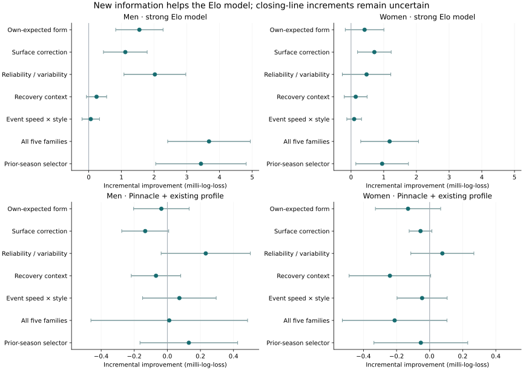

# New predictive features: brainstorm and measured tests

2 October 2026 · Research evidence, not a production or betting decision.

Observed: new features improve the strongest corrected existing Elo-based model. The combined model gains +3.679 [+2.414, +4.944] milli-log-loss for men and +1.180 [+0.296, +2.065] for women. The men's gain survives the 28-comparison adjustment used here; the women's does not. No new family demonstrates a clear increment over the existing model that already uses Pinnacle and the recent-statistics profile.

[The deep brainstorm: 38 directions and 15 primary sources](research.md)

[Machine-readable results, including every year and the average-market sensitivity](../../../data/studies/predictive_frontier/results.csv)

Positive means better: +1 milli-log-loss reduces average natural-log loss by 0.001. It is neither one percentage point of accuracy nor a betting return. Brackets are paired 95% intervals clustered in four-week calendar blocks. These historical seasons were examined in previous studies; even corrected and multiplicity-adjusted results remain exploratory.

## What was tested

| Family | New representation | Distinction / limitation |
| --- | --- | --- |
| Own-expected form | Serve/return point residuals against BOTH players' pre-match strengths; 28/182-day memory | Old adjperf adjusts for the opponent, rather than the player's own joint expectation. |
| Surface correction | Shrunk surface-specific innovation minus global innovation | A compact correction; not a refitted full Bayesian player-by-surface model. |
| Reliability / variability | Decayed point exposure and excess residual dispersion; interactions with strength | Approximate evidence quality and volatility, not calibrated posterior uncertainty. |
| Recovery context | Observed gaps, retirement losses and coverage, jointly with strength | Rest and retirement were already studied; this is a joint representation. Missing matches are not verified rest. |
| Event speed × style | Earlier-day service residuals from this edition × serve/return style | An inferred condition proxy, not measured court speed or the published ace-speed index. |


Built 27 signed inputs on 78,706 repaired matches. Point residuals shrink with 200 prior points; surface deviations with 400; event conditions with 800. Constants were fixed before the new score run. Every new rolling feature uses strictly earlier days. Supplied Elo and serve/return ratings retain the repair's earlier-day / strictly-earlier-same-event-round rule. Current outcomes, scores, box availability and retirement status enter later updates only.

The short, long and short-minus-long form columns are linearly dependent. They expose the chosen representation and affect ridge geometry; they are not independent information. The first unpenalized extension fit failed before candidate results were produced. Extensions then used positive ridge values 0.0001, 0.001, 0.01 and 0.1; old baselines kept their original fitting and penalties. No feature was changed in response to its measured gain.

## Increment over the strong Elo model

Comparator: the repaired nine-input Elo, serve/return, recent adjusted points, short IOS, games-weighted Elo, load, surface familiarity and age combination. It is the strongest corrected existing Elo ladder, not the invalidated earlier cached model or the unrepaired paid TabPFN result. Each model uses the same complete training/target rows within tour, expanding from 2013 and evaluating from 2019.

| Feature addition | Men: 18,174 matches | Women: 16,675 matches | Holm p: men / women |
| --- | --- | --- | --- |
| Own-expected form | +1.549 [+0.824, +2.274] | +0.415 [-0.176, +1.006] | 0.00138 / 1 |
| Surface correction | +1.119 [+0.451, +1.787] | +0.714 [+0.200, +1.228] | 0.0307 / 0.163 |
| Reliability / variability | +2.022 [+1.077, +2.968] | +0.476 [-0.265, +1.217] | 0.00138 / 1 |
| Recovery context | +0.240 [-0.069, +0.548] | +0.143 [-0.206, +0.492] | 1 / 1 |
| Event speed × style | +0.062 [-0.205, +0.329] | +0.096 [-0.129, +0.321] | 1 / 1 |
| All five families | +3.679 [+2.414, +4.944] | +1.180 [+0.296, +2.065] | 3.19e-06 / 0.209 |
| Prior-season selector | +3.432 [+2.048, +4.816] | +0.951 [+0.147, +1.756] | 0.000105 / 0.442 |


The combined men's log loss changes from 0.614337 to 0.610658; women's from 0.609822 to 0.608641. The three useful individual men's additions are reliability, own-expected form, and surface correction. Recovery and event speed supply no clear individual gain. Their inclusion in the combined model does not establish that they are necessary.

The selector chooses among the baseline, the five families and their combination using only the prior two seasons' out-of-season losses; it defaults to the baseline with fewer than 300 eligible validation matches. Ridge choices follow the same past-only rule. The reported selector is not an oracle that picks the eventual historical winner.

| Window | Men: combined | Men: past-only selector | Women: combined | Women: selector |
| --- | --- | --- | --- | --- |
| 2022_onward | +4.093 [+2.674, +5.513] | +3.722 [+2.059, +5.384] | +1.094 [+0.051, +2.137] | +0.912 [-0.050, +1.873] |
| 2024_2025 | +4.137 [+1.886, +6.388] | +4.137 [+1.886, +6.388] | +1.365 [-0.086, +2.816] | +0.948 [-0.147, +2.042] |


The men's improvement persists in 2022 onward and in the completed 2024–2025 seasons, so it is not confined to the first year following the ATP history gap. These windows were specified before scoring; they overlap and are not independent replications.

## Increment over the market-plus-statistics model

Comparator: annual Pinnacle calibration plus the 16-input recent adjperf/adjdef profile and serve/return, load, surface and age context. Men's baseline reproduces the repaired result; the women's version uses the analogous specification and is not a previously established WTA winner. Training begins in 2010. Average and Pinnacle fits use identical rows with both prices. A whole model family's features share its training-only ridge penalty, with the market coefficient unpenalized.

| Feature addition | Men: 16,333 matches | Women: 14,984 matches |
| --- | --- | --- |
| Own-expected form | -0.036 [-0.204, +0.132] | -0.131 [-0.328, +0.067] |
| Surface correction | -0.134 [-0.276, +0.008] | -0.055 [-0.124, +0.014] |
| Reliability / variability | +0.232 [-0.038, +0.502] | +0.077 [-0.114, +0.268] |
| Recovery context | -0.069 [-0.218, +0.081] | -0.240 [-0.487, +0.006] |
| Event speed × style | +0.073 [-0.149, +0.295] | -0.046 [-0.197, +0.106] |
| All five families | +0.011 [-0.462, +0.485] | -0.212 [-0.528, +0.105] |
| Prior-season selector | +0.130 [-0.165, +0.425] | -0.053 [-0.337, +0.230] |


None of these incremental intervals excludes zero. Reliability has the best men's point estimate, but its additional information beyond the existing strong market model is uncertain. Individual family results and the whole candidate ledger are retained, including negative results.

| Pinnacle-assisted forecast | Men vs raw Pinnacle | Men vs recalibrated Pinnacle | Women vs raw Pinnacle |
| --- | --- | --- | --- |
| Existing strong model | +0.632 [-0.123, +1.386] | +0.578 [-0.106, +1.263] | +0.416 [-0.154, +0.987] |
| Reliability / variability | +0.864 [+0.048, +1.679] | +0.810 [+0.062, +1.559] | +0.493 [-0.141, +1.128] |
| All five families | +0.643 [-0.041, +1.327] | +0.590 [-0.043, +1.222] | +0.205 [-0.473, +0.883] |
| Prior-season selector | +0.762 [-0.035, +1.558] | +0.708 [-0.015, +1.432] | +0.363 [-0.362, +1.089] |


The men's reliability-assisted forecast has a nominal positive interval against the plain line. That is a secondary, selected comparison combining the old profile with the new family; it does not demonstrate new conditional alpha. Its gain beyond the old market-plus-profile model spans zero, and the past-only market selector also spans zero against the plain line. Do not promote the best post-hoc plain-line comparison as a discovered betting edge.

| Market-free forecast vs raw Pinnacle | Men: 16,362 paired matches | Women: 15,003 paired matches |
| --- | --- | --- |
| Existing strong model | -24.170 [-28.158, -20.183] | -16.804 [-19.838, -13.771] |
| All five families | -20.733 [-24.160, -17.306] | -15.820 [-18.732, -12.908] |
| Prior-season selector | -20.993 [-24.331, -17.655] | -16.102 [-19.060, -13.143] |


On identical price-covered matches, the combined men's model closes 14.2% of the remaining Elo-combination-to-Pinnacle log-loss gap. Pinnacle remains substantially better. This fraction uses the paired market subset, not the larger all-match gain.

## Annual stability and the full experiment view

| Year | Men combined vs strong Elo | Women combined vs strong Elo |
| --- | --- | --- |
| 2019 | +4.566 [+2.320, +6.811] | -0.971 [-3.546, +1.603] |
| 2020 | +3.042 [-6.305, +12.389] | +3.732 [-0.385, +7.849] |
| 2021 | +1.002 [-4.290, +6.295] | +2.732 [-0.335, +5.799] |
| 2022 | +2.409 [+0.016, +4.802] | +0.593 [-1.517, +2.703] |
| 2023 | +3.518 [+0.449, +6.587] | -0.301 [-3.639, +3.038] |
| 2024 | +5.145 [+1.936, +8.354] | +1.384 [-0.860, +3.628] |
| 2025 | +3.077 [-0.483, +6.637] | +1.345 [-0.844, +3.534] |
| 2026 (partial) | +7.343 [+1.391, +13.294] | +3.117 [+0.848, +5.386] |




## Interpretation and next ideas

Inferred: uncertainty and a better distinction between stable ability and temporary form are productive directions for the sporting model. The market appears to contain much of this information already. These results do not imply a ceiling on pre-match predictability, nor do they rule out richer surface, condition or style models.

Suggested next experiments: a full joint surface-aware serve/return model; uncertainty integrated through the point-to-match conversion; and, among data already held, unreturned-serve quality, rally-length matchups, and serve-direction versus return-vulnerability interactions. The 38-idea register distinguishes these from raw statistics already tested. Shot-chart and tracking ideas were researched but not tested in this batch: their player/event joins, definitions and historical publication times need separate validation. This report does not claim to complete the existing shot-level study.

[Primary-source rationale: Ingram's point-based hierarchical tennis model](https://martiningram.github.io/papers/bayes_point_based.pdf)

[Primary-source rationale: Gollub's serve forecasting and shrinkage study](https://journals.sagepub.com/doi/10.3233/JSA-200345)

## Coverage, inference and verification

Accepted histories are main-tour matches with provider-supported match days; undated lower-level history is excluded. The repaired table spans 2010-01-03 to 2026-08-02, with no rows after the study's 2026-10-02 date. ATP 2018 is almost entirely absent: its 17 rows are 31 December matches from 2019-season editions. Pinnacle coverage in 2026 ends on 13 January for men and 14 January for women, while the model-only evaluation reaches August. Missing history changes exposure, apparent rest and rating quality.

Common complete cases preserve comparability within each route but differ between routes. Exact match-end, statistic-publication and quote timestamps remain unavailable; the feature chronology assumes prior-day results are available. Retrospective source matching establishes identity, not an executable forecasting feed. Published bookmaker rows are not verified tradable closing quotes; no returns, fees, spreads or settlement-specific betting test was run.

Holm adjustment covers 28 primary tests: five families, combined and selector, across two tours and the two primary routes, against their strong baselines in 2019 onward. Pointwise intervals and secondary raw-line/recent-window comparisons are not selection-adjusted. The correction does not undo previous study selection, guarantee independent calendar blocks, or prove robustness to serial player dependence across blocks.

Verification: 39 tests passed; zero skipped, failed or errored. Checks cover actual-date overlap mutations through rebuilt upstream ratings, current/future-result isolation with responsive later controls, day/event separation, paired invalid-box exclusion, surface pooling, gap decay, side exchange, training-only scaling, and past-only model selection. Cached baseline target coverage and labels match; maximum forecast difference is 3.2e-08. Input hashes and coefficients are saved; original study outputs were read, not overwritten.

[Frozen scoring protocol and input hashes](../../../data/studies/predictive_frontier/protocol.json)

[Feature definitions, constants, hashes and coverage](../../../data/studies/predictive_frontier/frontier_features_summary.json)

[Test evidence](../../../data/studies/predictive_frontier/tests.xml)

[Previous corrected study](../feature_alpha_audit/repairs.md)

## Reproduce

```bash
./python.sh -m src.eda.predictive_frontier.features
./python.sh src/eda/predictive_frontier/score.py
./python.sh -m pytest test/predictive_frontier test/feature_alpha_audit/test_repair_score.py test/feature_alpha_audit/test_profile_retest.py test/feature_alpha_audit/test_elo_retest.py -p no:cacheprovider --basetemp=data/studies/predictive_frontier/pytest_reproduction --junitxml=data/studies/predictive_frontier/tests.xml
./python.sh src/eda/predictive_frontier/report.py
./python.sh src/eda/feature_alpha_audit/check_report.py --document docs/studies/predictive_frontier/report.html --output-dir data/studies/predictive_frontier
```

On this Windows machine run through Git Bash with C:/Users/zerom/miniforge3/envs/tennis/Library/bin prepended to PATH. Use a fresh pytest temporary directory. No new package, paid model call or dataset acquisition was required.
