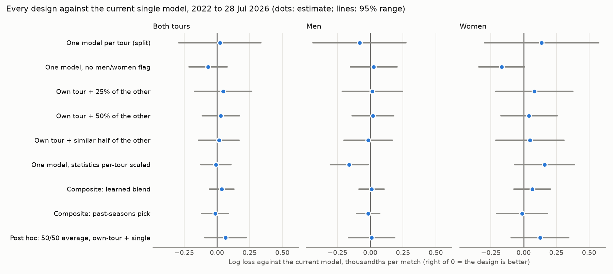
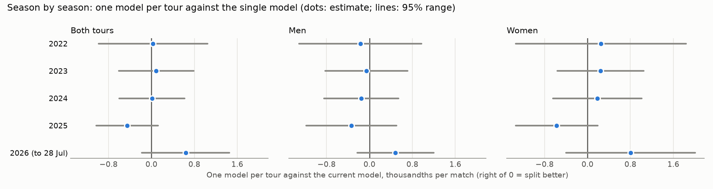

# Men and women: one model or two?

9 October 2026 · Written for the owner, as the business decision-maker · **A research recommendation, not a decision.** What enters the current best model stays the owner's call ([adoption framework](../adoption_framework/README.md)).

* **The design was declared before any result was read:** [design.md](design.md). Every later change is logged at its end.
* **For reviewers:** [audit_trail.md](audit_trail.md) gives the exact methods, the timeline of what was seen before each decision, the judgment calls, the threats to validity, and a checklist.
* **Code:** `src/eda/tour_pooling/`. **Evidence:** `data/studies/tour_pooling/`.

## The answer in one minute

* **Our recommendation: keep today's single model**, trained on both tours with its men/women flag. Change nothing.
* **What we tested.** Eight designs declared in advance, two added after the first results, and two controls, scored on 23,758 matches from 2022 to 28 Jul 2026.
  * **None beat today's model clearly.**
  * **One lost clearly:** putting each tour's statistics on a common scale made men's forecasts worse.
  * Everything else is unresolved: the data cannot tell it apart from today's model.
* **The measured differences are small.**
  * **Accuracy:** the estimates sit within ±0.07 thousandths of log loss per match (mLL) of today's model. Today's edge over the closing price is +1.16 mLL, so that is about 6% of it.
  * **Uncertainty:** the 95% ranges are wider, up to ±0.3 mLL (about a quarter of the edge) for two separate models.
  * **Money:** every alternative backtests within a few tenths of a percentage point of today's return. Today's model backtests at +1.4% per unit staked at Pinnacle's close, 2022 to Sep 2025.
* **Why separate men's and women's models don't help: a split does two things that roughly cancel.**
  * It halves the training data. That costs accuracy, and clearly so for men.
  * It keeps only the tour's own matches. That leans helpful, since own-tour matches look worth more row for row, but it is unresolved.
* **Keep the men/women flag.** Removing it leans worse, mostly for women: −0.17 mLL, P(better) 0.03, just short of a clear result.
* **Selective borrowing changed nothing measurable:**
  * 25% or 50% of the other tour's matches;
  * the "most similar" half;
  * a learned blend;
  * letting past seasons pick.
* **One lean, kept as a candidate, not acted on.** An even average of today's model and a women-only model reads +0.13 mLL for women (P(better) 0.87).
  * We found it after looking at the results.
  * Over half of its gain comes from 2026 alone.
  * Corrected for that search, its expected gain is about zero.
  * At this size, no realistic amount of new data would settle it. We log it and move on.
* **How close is the call?**
  * **Statistically,** the options are close: we cannot tell them apart.
  * **As a decision,** it is not close. No option shows a gain that survives the correction for trying ten designs. Every alternative adds a second model to maintain, and one hurts men.

### Every option at a glance

All on 2022 to 28 Jul 2026, both tours, against today's model. **+ = the option is better.**
* **Return** = the change in profit per unit staked when betting at Pinnacle's close (2022 to Sep 2025, about 9,000 bets).
* **P(better)** = the flat-prior reading of that one comparison. It does not allow for the ten designs tried.

| Option | In plain words | Accuracy, mLL per match [95% range] | P(better) | Return vs today | Extra cost | Our call |
|---|---|---|---|---|---|---|
| **Today's model** | one model, both tours, men/women flag | 0 | – | 0 (backtest +1.44% per unit) | – | **Keep** |
| Two models (split) | men's model on men only, women's model on women only | +0.02 [−0.29, +0.34] | 0.56 | +0.16 points | a second model | Decline |
| No flag | today's model without the men/women input | −0.07 [−0.21, +0.08] | 0.18 | +0.09 points | none | Decline: keep the flag |
| Own tour + 25% of the other | each tour's model sees a quarter of the other tour's matches | +0.05 [−0.17, +0.26] | 0.67 | +0.11 points | a second model | Decline |
| Own tour + 50% of the other | the same, half | +0.03 [−0.11, +0.17] | 0.66 | +0.22 points | a second model | Decline |
| Own tour + the "similar" half | half, picked to look like the own tour's matches | +0.01 [−0.14, +0.17] | 0.57 | +0.30 points | a second model and a classifier | Decline |
| Statistics on a common scale (aligned) | one model; each tour's statistics in units of its own spread | −0.01 [−0.12, +0.11]; **men −0.16 [−0.31, −0.02], worse** | 0.45 | +0.12 points | a transform | Decline: hurts men |
| Learned blend | past seasons decide how much to trust each tour's own model | +0.04 [−0.06, +0.13] | 0.79 | +0.18 points | two models, refitted weights | Decline |
| Past seasons pick | each tour uses whichever design did best in earlier seasons | −0.01 [−0.12, +0.09] | 0.39 | +0.05 points | all designs kept running | Decline |
| *After the fact:* 50/50 average | today's model averaged with an own-tour model | +0.07 [−0.09, +0.22]; women +0.13 [−0.09, +0.35] | 0.80; women 0.87 | +0.33 points (women +0.22) | a second model | Decline; keep as a candidate |

## What we were asked

Today one model learns from men's and women's matches together. It is told which tour each match belongs to (an input called `tour`), and each tour gets its own final calibration. You asked three things:

1. **Two models instead of one.** Train a men's model only on men's matches and a women's model only on women's matches, and compare them with the single model season by season from 2022.
2. **A men/women input.** If the model has none, add one and see whether it helps.
   * **It already has one.** So we tested the reverse: take it out and see what it was worth.
3. **Borrowing.** Let each tour's model learn mainly from its own matches, and add the other tour's matches at lower weight where they help. Find where they help and where they hurt, and build one or two models that borrow selectively.

## How we tested it, and how to read the numbers

* **Real-world replay.** Each design was rebuilt exactly as it would have run at the time:
  * the 2022 forecasts come from models trained only on 2013–2021;
  * the 2023 forecasts from 2013–2022, and so on;
  * no forecast ever saw the result it predicts.
* **Everything else is the current best model unchanged:** the same 58 inputs, the closing price among them; the same settings, calibration and serve-speed adjustment for men.
* **The comparison uses four runs (seeds) of each model.** Production averages 16, for every design alike.
* **Our runner rebuilt one of today's fits exactly** (2022, seed 0; difference 0.0), so the differences below come from the designs, not the tooling.
* **What was scored.**
  * 23,758 main-tour matches from 2022 to 28 Jul 2026, plus 2020–2024 as a second view.
  * **The matches from 29 Jul 2026 on were not touched.** They are our untouched reserve for confirming a change before money rides on it.
* **The score: log loss.** It is the standard grade for probability forecasts: lower is better, and a confident forecast that turns out wrong is punished hard.
  * We report each design's difference from today's model in thousandths of a log-loss point per match (**mLL**). **Plus means the design is better.**
* **The yardstick for size: our edge.** Today's model beats the closing price it is fed by **+1.16 mLL per match** (95% range +0.56 to +1.76; men +1.43, women +0.86).
  * The closing price is Pinnacle's where it exists. For 17.5% of the scored matches (from Aug 2025) it is BetOnline's, and for 1.3% the books' average. It is recalibrated per tour.
  * So a design worth +0.1 would add about a tenth of our edge, and one worth −0.1 would remove about a tenth.
* **How sure we are.**
  * Each result has a 95% range. If the range crosses zero, we call the result **unresolved**: the data cannot tell better from worse.
  * **P(better)** is the flat-prior reading of that one comparison: 0.5 is a coin flip, 0.95 or more is strong. It does not allow for the ten designs we tried.
  * Two things hold at once. The effects are small, and 24,000 matches are not enough to resolve effects this small.
  * Before recommending anything we correct for the luck of picking the best of many tries (§ 5).

## 1. Two models instead of one

| Window | Both tours | Men | Women |
|---|---|---|---|
| **2022 to 28 Jul 2026** | +0.02 [−0.29, +0.34], P 0.56 | −0.08 [−0.44, +0.27], P 0.32 | +0.14 [−0.30, +0.57], P 0.73 |
| 2020–2024 | −0.06 [−0.41, +0.28], P 0.36 | −0.16 [−0.57, +0.26], P 0.23 | +0.04 [−0.42, +0.50], P 0.57 |

+ = two models better. All unresolved.

**Season by season** it swings both ways, with no trend. Every season's reading is unresolved.

| Two models vs one | 2022 | 2023 | 2024 | 2025 | 2026 (to 28 Jul) |
|---|---|---|---|---|---|
| Both tours | +0.03 | +0.09 | +0.01 | −0.45 (P 0.06) | +0.64 (P 0.95) |
| Men | −0.17 | −0.06 | −0.15 | −0.34 | +0.48 |
| Women | +0.25 | +0.25 | +0.19 | −0.58 | +0.80 |

* For men, two models lean worse in four of five seasons.
* For women they lean better in four of five. The women's net lean comes largely from 2026 (+0.80), after 2025's −0.58.

**Why the two cancel.** A size control separates the two things a split changes. It is one model per tour, trained on a random draw from both tours as large as the tour's own data.

| 2022 to 28 Jul 2026, + = the first named better | Both tours | Men | Women |
|---|---|---|---|
| **Purer data:** own-tour only vs mixed, same size | +0.19 [−0.15, +0.54], P 0.86 | +0.23 [−0.21, +0.67], P 0.85 | +0.15 [−0.34, +0.64], P 0.73 |
| **More data:** double the rows, same mix | +0.17 [−0.01, +0.34], P 0.97 | **+0.31 [+0.02, +0.60], better** | +0.01 [−0.26, +0.29], P 0.53 |
| **Net: two models vs one** (purer minus more) | +0.02 | −0.08 | +0.14 |

* **For men, more data clearly helps.** Doubling the training rows reads better in both windows (2020–24: +0.39 [+0.10, +0.68]). Whether the women's matches are worth more to men than they cost as "the wrong tour" is unresolved: the men's net is −0.08.
* **"Own-tour matches are worth more row for row" is a lean** (P 0.86), not a finding. For women it reverses in 2020–24, where the mixed model leans better.
* *Inference.* With the closing price as an input, the model mostly learns how far to move away from the market, and the two tours largely share that lesson. That fits the earlier [surface study](../surface_ios/README.md), where splitting by court type also cost data without gaining accuracy.

## 2. The men/women flag

* **The model already has one:** the `tour` input. So we removed it to see what it was worth.
* **Result** (+ = removing the flag better):
  * both tours: −0.07 [−0.21, +0.08], P(better) 0.18;
  * men: +0.03, P 0.61;
  * **women: −0.17 [−0.34, +0.01], P 0.03**, just short of a clear "worse". 2020–24 agrees: women −0.12, P 0.06.
* **Read it as the flag's value given the model can still tell the tours apart.** It can, in two ways:
  * the indoor/outdoor input is recorded for men only, so a blank there means "women";
  * men's serve statistics spread wider.

  So "no flag" never makes the model blind to the tour; it only removes the explicit label. A truly blind model would need those removed too, which is not a production option.
* **Verdict:** keep the flag. It costs nothing, and removing it leans worse for women.

## 3. Borrowing from the other tour

### 3.1 How much to borrow

| Each tour's model sees… | Both tours | Men | Women |
|---|---|---|---|
| none of the other tour (two models) | +0.02 | −0.08 | +0.14 |
| 25% | +0.05 [−0.17, +0.26], P 0.67 | +0.02 | +0.08 |
| 50% | +0.03 [−0.11, +0.17], P 0.66 | +0.02 | +0.04 |
| 100% (today's model) | 0 | 0 | 0 |

2022 to 28 Jul 2026, against today's model, + = better. All unresolved: the dose makes no measurable difference. TabPFN takes no weights, so "lower weight" here means showing the model fewer of the other tour's matches.

### 3.2 Borrowing selectively, and the composed models

* **The "similar" half (borrowsim).**
  * **How it picks.** A classifier learned to tell the tours apart from what a match looks like: the market's favourite, the rating gaps, format, round and calendar. Each tour's model then borrowed the other tour's matches that look most like its own.
  * **What it borrows in practice:**
    * none of the other tour's Grand Slam matches, since best-of-five is men-only and best-of-three at a Slam women-only;
    * more of the closer-priced matches, 1000s and 250s, and less grass.
  * **Result:** +0.01 [−0.14, +0.17], P 0.57.
  * **Against a random half of the same size:** −0.02 [−0.13, +0.10] in 2022–26, and a lean worse in 2020–24 (P(better) 0.09). Picking "similar" matches adds nothing.
* **Statistics on a common scale (aligned).** One model, with each tour's box-score statistics in units of that tour's own spread. Men hold serve far more often than women, so the same raw gap means different things in each tour.
  * **Result:** −0.01 [−0.12, +0.11], P 0.45. But **clearly worse for men** (−0.16 [−0.31, −0.02]), and clearly worse overall in 2020–24 (−0.15 [−0.28, −0.02]).
  * Women lean better in 2022–26 (+0.16, P 0.92), but not in 2020–24 (−0.11).
  * *Inference (the analyst's):* part of the scale gap comes from how the inputs are built, not from tennis. Women's two-week serve form is shrunk twice as hard (§ 6), so "translating" it distorts the men's side.
* **Composed model 1: the learned blend.** For each tour, past seasons set how much weight goes to the own-tour model and how much to today's model.
  * **Result:** +0.04 [−0.06, +0.13], P 0.79; men +0.01, women +0.07 (P 0.83).
  * **The weights are essentially unidentified.** The own-tour model gets 0.18–0.29 of the weight for men and 0.13–0.51 for women, each with a 95% range of about ±0.7–1.1.
  * **It is not plain seed averaging.** The same blend built from two halves of today's own seeds reads −0.03, and the blend against it reads +0.07 (P 0.80).
* **Composed model 2: let past seasons pick.** Each tour uses whichever design did best on its earlier seasons.
  * **Its picks:**
    * men: today's model in 5 of 7 seasons (two models in 2021, 50% in 2023);
    * women: today's model in 2020–22, then 50% in 2023 and 25% in 2024–26.

    So the women's history drifts toward less borrowing.
  * **Result:** −0.01 [−0.12, +0.09], P 0.39; men −0.02, women −0.01. At effects this small, last season's winner is mostly luck.

### 3.3 Where the other tour's data helps, and where it hurts

We cut the matches by level, surface, format, round, season, favourite strength, missing data and the start of a surface season: 45 cells per comparison.

* **Only 1 of 45 cells clears zero, where about 2 would by chance.** It is women's heavy favourites, where today's model is worse than two models: −0.82 [−1.51, −0.14]. In 2020–21 it reverses.
* **Leans, all unresolved.** These are leads, not findings. The two windows share 2022–24, so leans that agree across them are not independent confirmation.
  * **Women.** The men's data leans harmful on clay (−0.62, P 0.04), on grass, at the Slams and for heavy favourites. It leans helpful on hard courts (+0.28, P 0.86) and in close matches (+0.40, P 0.85).
  * **Men.** The women's data leans helpful in 250s (+0.34; 2020–24 +0.64, P 0.95), on hard courts (2020–24 +0.39, P 0.92) and for heavy favourites (+0.28; 2020–24 +0.57, P 0.97).
* *Inference.* The other tour's data leans helpful where the two games are most alike, such as hard courts and close matches. It leans harmful for women where their game differs most from the men's: clay, the Slam format, heavy favourites.
* **The designs barely disagree.** Changing the training data moves a forecast by about 1 percentage point on average, against a price the market already sets well.

## 4. The money view

The project's backtest rules: back the side whose expected return is positive, with your staking (to win 1 unit on favourites, a little under 1 unit on underdogs). Profit per unit staked, both tours:

| | Pinnacle's close, 2022 to Sep 2025 | BetOnline's line, 2022 to Jul 2026 |
|---|---|---|
| **Today's model** | **+1.44%** [+0.44, +2.44], 9,136 bets | **+1.55%** [+0.28, +2.79], 8,841 bets |
| Two models | +1.60% (+0.16 points vs today, P 0.67) | +1.59% (+0.04) |
| Own + 50% of the other | +1.67% (+0.22, P 0.77) | +1.69% (+0.15) |
| Own + similar half | +1.75% (+0.30, P 0.83) | +1.35% (−0.20) |
| Statistics on a common scale | +1.56% (+0.12, P 0.70) | +1.96% (+0.42, P 0.92) |
| Learned blend | +1.62% (+0.18, P 0.76) | +1.90% (+0.35, P 0.91) |
| Past seasons pick | +1.49% (+0.05, P 0.53) | +1.49% (−0.05) |
| *After the fact:* 50/50 average | +1.77% (+0.33 [−0.23, +0.92], P 0.87); women +0.22 [−0.41, +0.88] | +1.96% (+0.41, P 0.88); women +0.10 [−0.76, +0.97] |
| Size control (half the data) | +1.14% (−0.30, P 0.19) | +1.15% (−0.40) |

* Every change sits within a few tenths of a point of today's model, and the 95% ranges straddle zero.
* A handful of the 40-odd cells by tour and book clear zero (the men's blend at BetOnline, for one). That is about what luck alone produces.
* *Context, not a verdict:*
  * these are in-sample backtests of the 4-seed versions;
  * the model's inputs were chosen on these seasons;
  * the prices are archived closes, not fills.

## 5. What we recommend, and how close the call is

1. **Keep today's model:** one model, both tours, men/women flag kept. No change to the template.
2. **Don't split, and don't adopt any borrowing scheme or composed model.** After correcting for picking the best of many tries, no candidate's expected gain is above zero, let alone above the upkeep of a second model:

   | Candidate | Gain | Correction for the pick | Gain after correction | Upkeep of a second model |
   |---|---|---|---|---|
   | Best declared design (own + 25%; best of 6) | +0.047 | 0.138 | −0.09 | ≈ 0.01 |
   | 50/50 average, both tours (after the fact; best of about 10) | +0.066 | 0.125 | −0.06 | ≈ 0.01 |
   | 50/50 average, women only (after the fact) | +0.125 | 0.17 | −0.04 (−0.08 counting the choice of tour) | ≈ 0.01 |

   The correction is the framework's rule: the standard error times the expected luck of the best of K tries.
3. **Keep the women's 50/50 average as a candidate, without building it.**
   * **Its gain by season** (women, + = better than today's model):

     | 2020 | 2021 | 2022 | 2023 | 2024 | 2025 | 2026 |
     |---|---|---|---|---|---|---|
     | −0.20 | −0.04 | +0.17 | +0.18 | +0.15 | −0.24 | +0.47 |

   * **2026 supplies over half of it.** 2022–25 alone read about +0.06.
   * **Its supporting readings are not independent.** The two-model, blend and 50/50 readings all reuse the same women's own-tour forecasts on the same matches.
   * **No realistic test could settle it.** A season of live women's matches measures it to about ±0.5 mLL, against a gain near 0.1. So no shadow run or decision date is proposed, and no sealed matches should be spent on it.
4. **Fix two data gaps.** They are independent of this decision (§ 6).

**How close is it?**
* **Statistically, close:** the designs cannot be told apart. The estimates differ by under a tenth of our edge, but the ranges reach a quarter of it.
* **As a decision, not close:** nothing shows a corrected gain, every alternative adds upkeep, and one hurts men.

**What would change our mind:**
* a much larger women's dataset (Challenger and ITF), which changes the "more data" side of the trade-off;
* a betting target where the price is softer, such as early prices (this study scored at the close only);
* a future change to how the women's inputs are built (§ 6), after which a re-test would be cheap.

**Suggestion line** (framework § 7):
* **Target:** bets at the close, both tours.
* **Provenance:** structural; eight designs declared, two added after the fact.
* **Cost class:** ≈ 0.01 for a second model; 0 for dropping the flag.
* **B · (est − sel) against c:** below 0 for every candidate.
* **Gates:**
  * realisation 0.98–1.10 for both tours, 0.89–1.14 by tour (no over-reaction);
  * no leak;
  * today's fit reproduced exactly.
* **Outcome:** keep today's model; decline every alternative; keep the women's 50/50 average as a candidate.
* **What would change it:** the three points above.

## 6. Things we found along the way

* **The indoor/outdoor input exists for men only.** It is blank on all 32,507 women's matches, so the blank itself tells the model "women".
  * Women's indoor status can be filled from tennis-data.co.uk's `Court` column, which covers 100% of their matches.
  * This is a candidate data fix for the owner.
* **The 127 men's matches of the 2026 US Open lack the indoor value too.** In training, that pattern means "women".
  * The live prediction chain should be checked for where a men's indoor value comes from for new events.
* **Women's two-week serve form is shrunk twice as hard as men's,** a built-in choice in the feature builder. The analyst infers this alone explains most of why men's form inputs spread 1.6–1.9 times wider.
* **About a quarter of women's 2013–18 matches carry estimated dates.** Their "days since the last match on this surface" are fractional. That fooled our second similarity sampler, as explained below.

## 7. How the work was done

* **The team.**
  * **The lead:** the design, the fit runner, the synthesis and this report.
  * **A statistician:** the scorer, which uses the decided comparison's recipe unchanged. It reproduced the decided comparison to 1e-13 and scored today's model against itself at exactly zero.
  * **A tennis and market analyst:** where borrowing helps, and what the similarity sampler borrows.
  * **A red team:** two reviews. The first found 2 blockers and 9 should-fixes before results were trusted ([review 1](../../../data/studies/tour_pooling/review/red_team_1.md)). The second audited this report's numbers and claims ([review 2](../../../data/studies/tour_pooling/review/red_team_2.md)).
* **Two flaws caught before any fit used them.** Both were in the similarity sampler:
  * the first version (lead and analyst) told the tours apart perfectly through the men-only indoor input, so it borrowed a plain random half;
  * the second (the analyst) selected on dating precision.
* **Checks.**
  * No fit trained on its own season or a later one, nor on a sealed match.
  * All 142 tests of the runner, scorer and segments pass. One expected failure records the indoor limitation.
  * The fits' software, checkpoint and job fingerprints are checked in the test suite, not in the scorer (the red team's S7, declared).
* **GPU.** 385 TabPFN fits: seven arms, seeds 0–3, 2019–2026, plus the reproduction fit. The one card was shared with other studies' runners, taking turns.
* **Looks at the proposed holdout.**
  * **No result from 29 Jul 2026 on was read.**
  * The exposed part (2025 to 28 Jul 2026) was read by five full scoring runs as the arms arrived (three by the statistician, one interim, one final) and two partial ones, and by the segment and money runs on the same forecasts.
  * No choice was made on it beyond the declared ones. The after-the-fact average is labelled as such and declined.
* **Changes after the first score:** see [design.md](design.md).

## Files

| Where | What |
|---|---|
| [design.md](design.md) | The pre-registered design and every amendment |
| [audit_trail.md](audit_trail.md) | Methods, chronology, judgment calls, threats to validity, reviewer checklist, reproduction |
| `src/eda/tour_pooling/common.py`, `fits.py`, `queue.sh` | Arms, training masks, the similarity sampler, the GPU runner |
| `src/eda/tour_pooling/score.py` | The scorer (`compare.py`'s recipe; composites; controls; realisation) |
| `src/eda/tour_pooling/segments.py`, `borrow_report.py` | Where borrowing helps; what the similarity draw borrows |
| `src/eda/tour_pooling/money.py`, `figures.py` | The return at the closes; this report's figures |
| `test/tour_pooling/` | The tests |
| `data/studies/tour_pooling/scores/` | scores.csv, composites.csv, realisation.csv, summary.json, forecasts.parquet |
| `data/studies/tour_pooling/segments/`, `borrow_report/`, `money/` | The analyst's tables and the return tables |
| `data/studies/tour_pooling/review/` | The red team's two reviews |
| `data/studies/tour_pooling/fits/` | The 385 fits |
